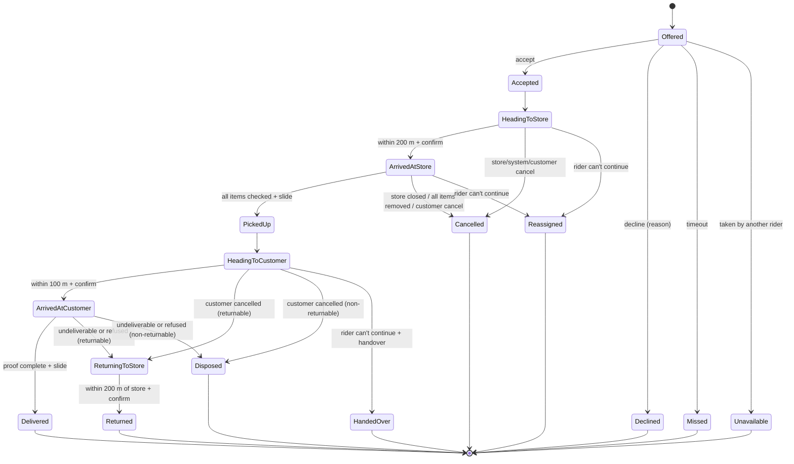

# Qwiko Delivery Partner App — Phased Implementation Plan

> Status: All phases (0–15) done in code: format, analyze, 269 tests, static audits, `flutter build web` and the debug APK (built and running on an Android phone via `flutter run`) pass. Added afterwards: riders stay signed in across launches, offline included (see Phase 3). The offer screen has a close button (it opens the decline reasons), and the decline sheet offers "Decline and go offline". Personal details can remove the profile photo; the KYC selfie document is kept. Still pending: removing the empty `lib/orders/` and `lib/profile/` folders, and the on-device manual checklist in Phase 15 (airplane mode, TalkBack, rotation, screen sizes, console, DevTools performance). Gap review applied (see [section 3.8](#38-flow-rules-and-gap-resolutions)); where section 3.8 and a phase disagree, section 3.8 wins.
> Location: `qwiko_delivery_agent/DELIVERY_PARTNER_APP_PLAN.md` (Flutter project root, next to `pubspec.yaml`).

This brief describes how to turn the existing `qwiko_delivery_agent` Flutter project into a production-quality **delivery-partner (rider) app**, comparable in scope to the partner apps used by Blinkit, Zepto, Swiggy Instamart and similar quick-commerce services. The app runs entirely on **realistic local demo data**. There is no backend, no API calls and no credentials. Google Maps will be plugged in later through a clean seam.

---

## Table of contents

1. [Project scope](#1-project-scope)
2. [Current codebase baseline](#2-current-codebase-baseline)
3. [Technical guidelines](#3-technical-guidelines) (incl. [3.8 Flow rules and gap resolutions](#38-flow-rules-and-gap-resolutions))
4. [UX guidelines](#4-ux-guidelines)
5. [Phased implementation](#5-phased-implementation)
   - [Phase 0 — Baseline cleanup](#phase-0--baseline-cleanup)
   - [Phase 1 — Architecture, models and demo data layer](#phase-1--architecture-models-and-demo-data-layer)
   - [Phase 2 — Design system and reusable components](#phase-2--design-system-and-reusable-components)
   - [Phase 3 — App entry, demo sign-in and verification states](#phase-3--app-entry-demo-sign-in-and-verification-states)
   - [Phase 4 — Home dashboard and availability](#phase-4--home-dashboard-and-availability)
   - [Phase 5 — Incoming delivery offers](#phase-5--incoming-delivery-offers)
   - [Phase 6 — Mock map, location and route seam](#phase-6--mock-map-location-and-route-seam)
   - [Phase 7 — Pickup flow](#phase-7--pickup-flow)
   - [Phase 8 — Delivery leg and customer contact](#phase-8--delivery-leg-and-customer-contact)
   - [Phase 9 — Proof of delivery, payment collection and completion](#phase-9--proof-of-delivery-payment-collection-and-completion)
   - [Phase 10 — Completed orders and activity history](#phase-10--completed-orders-and-activity-history)
   - [Phase 11 — Earnings, incentives, cash in hand and payouts](#phase-11--earnings-incentives-cash-in-hand-and-payouts)
   - [Phase 12 — Profile, documents, settings and notifications](#phase-12--profile-documents-settings-and-notifications)
   - [Phase 13 — Help, support and safety](#phase-13--help-support-and-safety)
   - [Phase 14 — Demo controls, accessibility and responsive hardening](#phase-14--demo-controls-accessibility-and-responsive-hardening)
   - [Phase 15 — Final quality phase](#phase-15--final-quality-phase)
6. [Demo scenarios](#6-demo-scenarios)
7. [Future integration points](#7-future-integration-points)
8. [Appendix A — Order state machine](#appendix-a--order-state-machine)
9. [Appendix B — Control inventory template](#appendix-b--control-inventory-template)
10. [Appendix C — Validation rules](#appendix-c--validation-rules)

---

## 1. Project scope

### Who it is for

Delivery partners (riders) only. Customers and merchants never use this app; they appear only as data (names, addresses, store counters) inside a rider's tasks.

### In scope

- The full rider workflow: sign-in and verification status, home dashboard, going online or offline, receiving delivery offers, accepting or declining, navigating to the store, pickup, navigating to the customer, proof of delivery, cash-on-delivery (COD) collection, completion summary, order history, activity log, earnings, incentives, cash-in-hand, payouts, profile, documents, vehicle, bank, ratings, settings, notifications, help and support, and safety (SOS, emergency contacts, insurance, incident reporting).
- Production-quality UI: loading, empty, error, disabled, offline and success states; validation; confirmation steps for consequential actions; accessibility; responsive layouts from small phones to tablets.
- A **mock map and route experience** that works fully offline and a clean seam for Google Maps, Routes and live GPS later.
- **Demo mode** that is always clearly labelled, deterministic, resettable, and controllable through an in-app Demo Controls panel.

### Out of scope (for this plan)

- Backend services, REST/GraphQL/WebSocket clients, push notifications, authentication servers, file uploads, payment gateways, analytics and crash reporting. Each is listed as a future integration point in [section 7](#7-future-integration-points).
- Any network request at runtime. The app must work in airplane mode.
- Customer and merchant apps, admin dashboards.
- Real Google Maps rendering until an API key is provided.
- Referral programmes, rider shop/merchandise, and loans/advances (common in market apps, but deferred to keep scope focused).
- Also deferred deliberately (market parity, not forgotten): shift/slot booking, minimum earnings guarantee and idle pay, penalties and fraud scoring (fake-GPS detection), pre-first-order training modules, bag/asset (T-shirt, bag) collection, age/prescription verification for pharmacy orders, and process-death persistence of an active order.

### Target platforms

- Primary: Android (phones and tablets) and iOS.
- Secondary (layout verification only): Flutter web and Windows desktop, provided no `dart:io`-only code path is reachable on web (see Phase 0).

---

## 2. Current codebase baseline

The plan builds on what already exists rather than replacing it.

### Toolchain and dependencies

| Item | Current value |
| --- | --- |
| Flutter / Dart | Flutter 3.47.7 stable, Dart 3.13.5 (`sdk: ^3.13.5`) |
| UI | Material 3 (`useMaterial3: true`), seed colour `AppColors.primary` (`#0C7634`) |
| Lints | `flutter_lints ^6.0.0` via `analysis_options.yaml` |
| Runtime deps | `cupertino_icons`, `latlong2`, `geolocator`, `url_launcher`, `http`, `image_picker`, `google_maps_flutter` |
| Dev deps | `flutter_test`, `flutter_lints`, `flutter_launcher_icons` |
| Assets | `assets/images/logo.png`, `assets/icon/app_icon.png` |
| Maps key wiring | Android: `MAPS_API_KEY` in `android/local.properties`, injected via `manifestPlaceholders["mapsApiKey"]`. iOS: `GMSServices.provideAPIKey("PASTE_YOUR_GOOGLE_MAPS_API_KEY_HERE")` in `AppDelegate.swift`. Dart: `AppConfig.googleMapsApiKey` from `--dart-define=MAPS_API_KEY`. |

No new third-party packages are required by this plan. Anything optional is called out explicitly.

### Existing structure (to keep and extend)

```
lib/
  main.dart                       QwikoApp, theme, named routes
  config/app_config.dart          MAPS_API_KEY dart-define
  data/app_state.dart             AppState singleton (ChangeNotifier): profile + settings
  data/dummy_data.dart            PastOrder, AppNotification, Payout, DummyData (static lists)
  models/delivery_order.dart      DeliveryOrder + DeliveryOrder.sample()
  models/rider_profile.dart       RiderProfile, DocumentType, requiredDocuments, vehicleTypes
  services/location_service.dart  geolocator wrapper
  services/route_service.dart     Google Routes API -> OSRM -> straight line (HTTP)
  services/image_service.dart     camera/gallery bottom sheet via image_picker
  utils/app_colors.dart, utils/formatters.dart
  widgets/app_text_field.dart, widgets/primary_button.dart
  screens/
    splash/  auth/ (login, signup, otp, forgot/reset password)
    kyc/ (kyc, verification_pending)
    home/home_screen.dart         935 lines: tabs, dashboard, online toggle, incoming order, profile tab
    orders/ (active_order, chat, order_details, order_history_view)
    earnings/earnings_view.dart
    profile/ (personal, vehicle, documents, bank)
    notifications/, settings/, support/
```

### Issues found during inspection

These must be resolved before or during the phases below.

1. **Network calls at runtime.** `RouteService` makes HTTP requests to the Google Routes API and the public OSRM demo server (`router.project-osrm.org`). `ActiveOrderScreen` calls it on every leg. This violates the no-network requirement.
2. **Real Google Map without a key.** `ActiveOrderScreen` renders `gmaps.GoogleMap` directly. With the placeholder key it shows a blank or grey map (and can fail on iOS).
3. **Real device location.** `ActiveOrderScreen` requests location permission through `LocationService` and rewrites the sample order around the device's real position. The demo should be deterministic and not depend on GPS.
4. **External intents for fake data.** "Navigate" opens Google Maps and "Call" opens the dialer for fake numbers (`9876500001`, `18001234567`).
5. **UI state mixed with demo data.** `HomeScreen` owns online state, timers, today's stats and the incoming offer; `EarningsView` mutates `DummyData.payouts` directly; `DummyData` exposes mutable static lists. Stats reset whenever the screen is rebuilt.
6. **Broken test.** `test/widget_test.dart` pumps `MyApp` and checks a counter; the app class is `QwikoApp`, so `flutter test` fails to compile.
7. **Runtime assertion in the running app.** `ListTile` placed inside a `Container` with a background colour triggers "ListTile background color or ink splashes may be invisible" repeatedly (profile list in `home_screen.dart`, and the same pattern in `settings_screen.dart`).
8. **Empty placeholder files.** `lib/models/order_model.dart`, `lib/services/api_service.dart`, `lib/widgets/order_cart.dart`, `lib/widgets/status_badge.dart`, plus stray `lib/orders/` and `lib/profile/` folders containing empty files.
9. **Web incompatibility.** `home_screen.dart` uses `dart:io` `File` with `FileImage`, which does not work on web.
10. **No-op setting.** The language picker stores a value but changes nothing.
11. **Inconsistent validation.** Login accepts 6-character passwords while sign-up and reset require 8.
12. **Colour contrast.** `AppColors.textGrey` (`#778196`) on white is about 3.9:1, below the 4.5:1 WCAG AA requirement for body text. White text over the `AppColors.accent` (`#64BA0F`) end of the online-card and help-card gradients is about 2.5:1. `Colors.redAccent` and `Colors.orange` used as text colours also fall below 4.5:1.
13. **No demo labelling.** Nothing tells the user that orders, payouts, calls and maps are simulated.
14. **Default identifiers.** `applicationId` is still `com.example.qwiko_delivery_agent`; `pubspec.yaml` description and `README.md` are the Flutter defaults.

---

## 3. Technical guidelines

### 3.1 Architecture

Use a layered structure that keeps widgets free of demo data and makes every data source swappable for a real one later.

```
UI (screens, widgets)
   │ listens to
Controllers (ChangeNotifier, one per feature; hold UI-facing state)
   │ call
Repositories (abstract interfaces)          Platform seams (abstract interfaces)
   │ implemented by                            │ implemented by
Demo repositories (in-memory, seeded)       Demo implementations (mock map, simulated location, etc.)
   │ read from                                 │
DemoSeed + DemoEngine (clock, scenarios, simulated latency, failure injection)
```

Rules:

- **State management stays with what the project already uses**: `ChangeNotifier` plus `ListenableBuilder` (already used by `HomeScreen`). No new state package is required. If the team later prefers `provider` or `riverpod`, the controller boundaries in this plan map one-to-one.
- **Dependency injection** through a single `AppServices` object created in `main()` (`AppServices.demo()` now, `AppServices.live()` later) and exposed with an `InheritedWidget` named `AppScope`. Widgets call `AppScope.of(context).orders` instead of touching singletons. The existing `AppState.instance` is migrated into `ProfileController` and `SettingsController` and then removed.
- **Widgets never import `data/demo/`.** Only `AppServices.demo()` does. A simple check in the quality phase greps for violations.
- **Controllers never import Flutter widgets** except `foundation.dart` (for `ChangeNotifier`) so they are unit-testable.
- **Repository methods are asynchronous** (`Future` / `Stream`) even in demo mode, with small simulated latency (150–600 ms, configurable, zero in tests). This forces real loading states into the UI now.
- **Errors are typed.** Repositories return a sealed `Result<T>` (`Ok` / `Err(AppFailure)`) or throw typed `AppFailure` subclasses (`NetworkUnavailableFailure`, `ValidationFailure`, `NotAllowedFailure`, `NotFoundFailure`). Demo failure injection produces the same types a real API client would.
- **Time is injected.** A `Clock` interface (`SystemClock`, `DemoClock` with speed multiplier) drives offer countdowns, ETAs and timestamps so demos and tests are deterministic.
- **IDs and randomness are seeded** (`Random(seed)`), so the same scenario always produces the same orders.

### 3.2 Proposed folder layout

Extends the current layout; existing screen folders stay where they are.

```
lib/
  main.dart                       builds AppServices.demo() and runs QwikoApp
  app/
    app.dart                      QwikoApp (MaterialApp, theme, routes) moved out of main.dart
    app_scope.dart                InheritedWidget exposing AppServices
    app_routes.dart               route names + onGenerateRoute (typed arguments)
    app_theme.dart                ThemeData, colour scheme, text theme, component themes
  config/
    app_config.dart               MAPS_API_KEY (existing) + MAP_PROVIDER, DEMO_MODE flags
  core/
    clock.dart  result.dart  failures.dart  validators.dart  ids.dart
    formatters.dart               moved from utils/ (keep a re-export during migration)
  models/                         typed, immutable models (section 3.3)
  data/
    repositories/                 abstract interfaces
    demo/
      demo_seed.dart              seeded partners, stores, customers, orders, history
      demo_engine.dart            clock, latency, failure injection, scenario runner
      demo_scenarios.dart         scripted scenarios (section 6)
      demo_*_repository.dart      in-memory implementations
  services/                       platform seams (interfaces + demo implementations)
    maps/      map_renderer.dart, mock_map_view.dart, google_map_view.dart (unwired)
    routing/   route_planner.dart, mock_route_planner.dart, google_route_planner.dart (unwired; today's RouteService)
    location/  location_source.dart, simulated_location_source.dart, device_location_source.dart (unwired; today's LocationService)
    media/     media_picker.dart (wraps today's ImageService + sample-photo fallback)
    contact/   contact_launcher.dart, demo_contact_launcher.dart
  controllers/                    one ChangeNotifier per feature
  screens/                        existing folders + offers/, delivery/, incentives/, activity/, safety/, demo/
  widgets/                        reusable components (Phase 2)
  utils/app_colors.dart           kept; becomes the token source for app_theme.dart
```

### 3.3 Typed models

All models are immutable (`final` fields, `const` constructors, `copyWith`), use enums instead of strings for states, and keep money as **integer paise** (`int amountPaise`) to avoid floating-point rounding. `formatRupees` gets an overload that accepts paise.

| Model | Key fields |
| --- | --- |
| `PartnerProfile` (evolves `RiderProfile`) | `id`, `name`, `phone`, `email`, `address`, `photo` (`MediaRef`), `rating` (`RatingSummary`), `joinedOn`, `verification` (`VerificationStatus`: newSignup, pending, verified, rejected, suspended), `suspensionReason?`, `vehicle` (`Vehicle`), `bank` (`BankAccount?`), `upiId`, `documents` (`List<PartnerDocument>`), `emergencyContacts`, `homeZoneId` |
| `RatingSummary` | `average`, `count`, `distribution` (1–5 star counts), `recentCompliments`, `tips`; updated by `ratingReceived` events |
| `PartnerDocument` | `type` (`DocumentType` enum: photo, aadhaar, pan, license, rc, insurance, pucc), `status` (notUploaded, pending, verified, rejected, expiringSoon, expired), `rejectionReason`, `expiresOn`, `media` |
| `Vehicle` | `type` (bike, scooter, eBike, cycle), `registrationNumber`, `model`, `isEv` |
| `BankAccount` | `holderName`, `maskedAccountNumber`, `ifsc`, `bankName`, `verification` |
| `DeliveryZone` | `id`, `name`, `center`, `demand` (low, normal, high, surge), `surgeMultiplier` |
| `AvailabilityState` | `status` (offline, online, onBreak), `onlineSince`, `breakEndsAt`, `zoneId`, `idlePosition` (`GeoPoint`, rider position when not on a trip), `blockers` (`List<OnlineBlocker>`) |
| `OnlineBlocker` | `type` (documentExpired, verificationPending, accountSuspended, cashLimitReached, locationPermissionOff, networkOffline), `message`, `fixLink` (`AppLink`) |
| `DeliveryOffer` | `id`, `orders` (1–2; 2 = batched), `pickup` (`Stop`), `drops` (`List<Stop>`), `distanceToPickupM`, `tripDistanceM`, `estimatedMinutes`, `payout` (`PayoutBreakdown`), `shownAt?` (set when the sheet becomes visible), `timeoutSeconds` (30), `expiresAt` (derived: `shownAt + timeoutSeconds`), `itemCount`, `bagSize`, `paymentMode`, `codAmountPaise`, `tags` (heavy, fragile, coldChain, pharmacy) |
| `PayoutBreakdown` | `basePaise`, `distancePaise`, `surgePaise`, `waitingPaise`, `batchBonusPaise`, `compensationPaise`, `tipPaise` (`total` getter) |
| `DeliveryTrip` (new) | `id`, `offerId`, `store` (`StoreInfo`), `tasks` (`List<DeliveryTask>`, ordered by drop sequence; length 1 or 2), `currentTaskIndex`, `status` (`TripStatus`: headingToStore, atStore, inProgress, returningToStore, completed, cancelled), `routeSnapshot` (`List<GeoPoint>` of the full planned route, kept for history), `waitStartedAt?`, `waitingPaise` |
| `DeliveryTask` (evolves `DeliveryOrder`) | `orderId`, `displayId`, `tripId`, `store` (`StoreInfo`), `customer` (`CustomerInfo`), `items` (`List<OrderItem>`), `payment` (`PaymentInfo`), `requiredProof` (`ProofMethod`: otp, photo, otpAndPhoto), `deliveryOtp`, `isReturnable`, `promisedBy` (`DateTime`, for on-time rate), `status` (`OrderStatus`, Appendix A), `timeline` (`List<OrderEvent>`), `proof` (`DeliveryProof?`), `issues` (`List<IssueReport>`), `payout`, `contactAttempts` |
| `IssueReport` | `id`, `type` (orderNotReady, itemMissing, itemDamaged, storeClosed, wrongOrder, addressNotFound, customerUnreachable, customerRefused, vehicleBreakdown, payMissing, wrongDistance, tipMissing, other), `affectedItems`, `note`, `media?`, `at`, `outcome` (waiting, continued, replaced, removed, cancelled, escalated), `ticketId?` |
| `StoreInfo` | `name`, `address`, `location`, `maskedPhone`, `pickupInstructions`, `counterLabel` |
| `CustomerInfo` | `firstName`, `maskedPhone`, `addressLine`, `floor`, `landmark`, `location`, `instructions`, `preferences` (leaveAtDoor, doNotRing, contactless) |
| `OrderItem` | `name`, `quantity`, `unit`, `unitPricePaise`, `isPicked`, `status` (normal, missing, damaged, replaced, removed) |
| `PaymentInfo` | `mode` (prepaid, cod), `orderValuePaise` (basket value incl. fees, used for the high-value rule), `amountToCollectPaise` (0 for prepaid; recomputed when items are removed) |
| `DeliveryProof` | `method` (otp, photo, otpAndPhoto), `otpVerified`, `photo`, `cashCollectedPaise`, `changeGivenPaise`, `collectedVia` (cash, upiQr, split), `upiCollectedPaise`, `capturedAt` |
| `OrderEvent` | `type` (offered, accepted, arrivedAtStore, pickedUp, arrivedAtCustomer, delivered, cancelled, returningToStore, returned, issueReported, callAttempted, chatSent, proofCaptured, ratingReceived), `at`, `note`, `queued` (true while recorded offline and not yet synced) |
| `EarningEntry` | `type` (orderPay, waitingPay, surge, batchBonus, compensation, tip, incentive, adjustment, payout), `amountPaise`, `at` (timestamp of the credit, which decides its day), `orderId?`, `label`. Cash movements are not earnings and live in `CashInHand`. |
| `AppLink` | `route` (order, trip, incentive, payout, document, ticket, safety, cashInHand), `id?`; resolved by `onGenerateRoute` |
| `Incentive` | `id`, `type` (dailyMilestone, peakHours, weeklyTarget, rainBonus), `title`, `tiers` (`target`, `rewardPaise`), `progress`, `window` (start/end), `status` (upcoming, active, achieved, missed), `terms` |
| `CashInHand` | `balancePaise`, `limitPaise`, `movements` (`List<CashMovement>`: codCollected +, changeGiven −, deposit −), `deposits` (`List<CashDeposit>`) |
| `WalletBalance` | `withdrawablePaise` (sum of credited `EarningEntry`s minus payouts), `pendingPaise` (tips/adjustments not yet settled), `nextScheduledPayoutOn` |
| `Payout` | `id`, `amountPaise`, `requestedAt`, `status` (requested, processing, paid, failed), `reference`, `failureReason`, `isInstant`, `isScheduled`, `destination` (bank only in demo), `feePaise` |
| `ActivityEvent` | `type` (wentOnline, wentOffline, breakStarted, offerAccepted, offerDeclined, offerMissed, delivered, cancelled, payoutRequested, sos), `at`, `details` |
| `AppNotification` (moved from `dummy_data.dart`) | `id`, `category` (offer, earnings, incentive, account, safety, system), `title`, `body`, `at`, `isRead`, `deepLink` (`AppLink`) |
| `SupportTicket` / `SupportMessage` | Ticket: `id`, `category`, `source` (order, incident, help, chat), `orderId?`, `incidentId?`, `status` (open, awaitingYou, resolved), `messages`, `createdAt`. Message: `id`, `from` (rider, agent, system), `text`, `attachments` (`List<MediaRef>`), `at` |
| `FaqArticle` | `id`, `category`, `question`, `answer`, `keywords` |
| `EmergencyContact` | `name`, `relation`, `phone` |
| `SafetyIncident` | `type` (sos, accident, harassment, vehicleBreakdown, other), `at`, `location`, `description`, `status` |
| `MediaRef` | `source` (file, sample), `path` or `sampleId`; renders through one `MediaImage` widget that works on web and mobile |
| `GeoPoint` | wraps `latlong2.LatLng` so models do not depend on a map SDK |

### 3.4 Controllers

| Controller | Responsibility |
| --- | --- |
| `SessionController` | demo sign-in, sign-out, onboarding/verification gate |
| `AvailabilityController` | online/offline/break, blockers, online timer, zone |
| `OfferController` | offer stream, countdown, accept/decline/miss, decline reasons |
| `ActiveTripController` | the active `DeliveryTrip` and its tasks, the order state machine ([Appendix A](#appendix-a--order-state-machine)), drop sequencing, route, arrival detection, issues, proof of delivery, offline action queue |
| `NavigationController` | simulated rider position, route progress, ETA, turn-by-turn steps |
| `HistoryController` | completed/cancelled orders, filters, search, activity log |
| `EarningsController` | day/week/month summaries, breakdowns, chart data |
| `IncentivesController` | incentive progress and status |
| `WalletController` | cash in hand, deposits, payouts, withdraw |
| `ProfileController` | profile, documents, vehicle, bank, emergency contacts |
| `SettingsController` | language, notification and sound preferences, text-size preview |
| `NotificationsController` | inbox, unread count, mark read, deep links |
| `SupportController` | FAQs, tickets, support chat |
| `SafetyController` | SOS flow, incidents, trip sharing |
| `DemoController` | scenario selection, speed, failure injection, reset |

### 3.5 Platform seams and the no-network rule

| Seam | Demo implementation (default) | Future implementation (already partly in repo) |
| --- | --- | --- |
| `MapRenderer` | `MockMapView` (CustomPainter) | `GoogleMapView` using `google_maps_flutter` (code moved from `ActiveOrderScreen`) |
| `RoutePlanner` | `MockRoutePlanner` (offline, deterministic) | `GoogleRoutePlanner` (today's `RouteService._googleRoute`) |
| `LocationSource` | `SimulatedLocationSource` (moves along the route) | `DeviceLocationSource` (today's `LocationService`) |
| `ContactLauncher` | `DemoContactLauncher` (in-app "simulated call" sheet) | `UrlLauncherContactLauncher` (masked-number calling via backend) |
| `MediaPicker` | `image_picker` when available, plus "Use sample photo" fallback | same, plus upload |
| `ExternalNavigation` | in-app demo navigation screen | Google Maps intent (today's `_openNavigation`) |

Rules:

- The demo build must **not execute any code path that imports `package:http`**. `RouteService`'s OSRM fallback is deleted (a public demo server is not suitable for production either); its Google branch moves into `GoogleRoutePlanner`, which is not registered in `AppServices.demo()`.
- `AppConfig` gains `MAP_PROVIDER` (`mock` by default, `google` later) and `DEMO_MODE` (`true` by default). The Google renderer is selected only when `MAP_PROVIDER=google` **and** `hasGoogleMapsKey` is true; otherwise the mock renderer is used and a debug log explains why.
- The only external intent allowed in demo mode is **"Call 112"** from the safety screen, which opens the system dialer pre-filled (it does not place the call). Hiding real emergency calling behind a simulation would be unsafe. This is labelled on screen.
- Device GPS, camera and gallery are local (no network) but optional: the demo works fully without granting any permission.

### 3.6 Performance and robustness

- Map and timers: wrap the map in a `RepaintBoundary`; tick the simulated rider at most every 500 ms; cancel every `Timer` and `StreamSubscription` in `dispose`.
- Lists use `ListView.builder`/`SliverList`; history is paginated in pages of 20 from the demo repository.
- Long-running flows (active order) survive tab switches and back navigation because state lives in controllers, not widgets. Re-entering the app from the dashboard shows "Resume active order".
- No `print`; use `debugPrint` behind a `kDebugMode` check.

### 3.7 Testing strategy

- Unit tests: validators, formatters (paise to rupees, Indian grouping), order state machine transitions (allowed and rejected), payout and incentive maths, offer expiry with `DemoClock`.
- Widget tests: go online and receive an offer; accept and complete a prepaid delivery; COD with change; decline with reason; wrong OTP lockout; withdraw validation; SOS cancel within countdown. Tests use `AppServices.demo(latency: Duration.zero, clock: FakeClock())`.
- Optional golden tests for key cards at text scale 1.0 and 2.0.

### 3.8 Flow rules and gap resolutions

These rules close gaps found in review. They apply across phases and override any phase text that disagrees.

#### 3.8.1 Simulated offline network policy

When the demo network toggle is off, actions fall into three groups:

| Group | Actions | Behaviour |
| --- | --- | --- |
| Local, always allowed | Viewing any screen, map, navigation, item checklist, OTP entry, photo capture, change calculation, SOS countdown, "Call 112" | Work normally |
| Queued (active trip only) | Arrived at store, picked up, arrived at customer, delivered, returned, call/chat attempts, issue reports | Applied locally at once, recorded with `queued: true`, shown with a "Will sync when online" chip, flushed in order on reconnect. A queued step never blocks the next local step. |
| Server-required, disabled | Going online, receiving offers, accepting an offer, withdraw, cash deposit, creating tickets, support chat, document/bank save | Disabled with "You're offline. This needs a connection." |

UPI collection requires a connection; when offline the COD screen offers cash only and says why. If the network drops while an offer sheet is open, the offer is withdrawn ("Connection lost. Offer released.") and is not counted as missed.

#### 3.8.2 Trips and batched orders

- Accepting any offer creates one `DeliveryTrip` containing 1 or 2 `DeliveryTask`s. The trip owns pickup, waiting and route; each task owns its own drop, proof, payment and status.
- Pickup happens once for the whole trip. The item checklist groups items per order.
- Drops run in the order of `tasks`. After a drop is delivered, the panel shows a short "Drop 1 delivered · ₹ earned" confirmation and moves straight to drop 2. **The completion screen appears only when every task in the trip has reached an end state.**
- If one drop becomes undeliverable or is cancelled by the customer, the other drop continues first; the failed order's return to store is scheduled after the last drop (or immediately if it is the last). Batch bonus is paid only if both drops are delivered.
- The rider can have only one active trip. Offers are not shown during a trip.

#### 3.8.3 Cancellation and handover matrix

| When | Who cancels | Rider action | Rider pay |
| --- | --- | --- | --- |
| Heading to store | Store/system or customer | Trip ends, back to Home | ₹15 compensation if > 500 m travelled, else ₹0 |
| At store (before pickup) | Store (closed, out of stock) or customer | Trip ends after rider confirms "I'm leaving the store" | ₹15 + waiting pay accrued |
| After pickup, order returnable | Customer, or undeliverable | Return-to-store leg | 50% of order pay + distance to customer + waiting pay |
| After pickup, order non-returnable (perishable/pharmacy) | Customer, or undeliverable | "Keep or dispose as instructed" screen, no return leg | 50% of order pay + waiting pay |
| Any time | Rider ("I can't continue": vehicle breakdown, accident, unwell) | Reason → confirm dialog → support "reassigns" the order after 10 s demo delay. If picked up, rider waits for handover at a shown meeting point and confirms "Handed over". | Pay for distance already covered; no acceptance-rate penalty for safety reasons |

All compensation is written as `EarningEntry(type: compensation)`. Rider cancellations require a reason and create an `IssueReport` and an `ActivityEvent`.

#### 3.8.4 Store issue outcomes

| Issue | Outcome in demo |
| --- | --- |
| Order not ready | Wait continues; waiting pay accrues after 5 min; after 15 min "Cancel and get compensation" is enabled |
| Item missing / damaged | Select items → store "replaces" (item status `replaced`) or "remove item" (status `removed`). COD amount and order value are recomputed from `unitPricePaise`. Rider pay is unchanged. If every item is removed, the order is cancelled at store with compensation. |
| Store closed | Rider must be inside the geofence; cancel with compensation |
| Wrong order handed over | Rider re-checks with the item checklist; store "fixes" after 60 s demo delay |

#### 3.8.5 Proof-of-delivery precedence

1. `requiredProof` is set by the seed/generator, not inferred on screen.
2. If `orderValuePaise > ₹2,000` → `otpAndPhoto`, whatever else applies.
3. COD orders are **never** leave-at-door. Contactless preference only changes the hand-over instruction ("Place on the doormat and step back"); OTP or photo still applies.
4. Prepaid leave-at-door orders use `photo`.
5. **Customer refuses the order** (at customer, after arrival) → reason → treated as undeliverable without the call/wait requirement.
6. **Customer pays less than due** → not allowed to complete; offers "Customer pays rest by UPI" (split) or "Report payment issue" (support decides; demo resolves as undeliverable).
7. **Rider has no change** → "Ask customer to pay exact amount or by UPI" helper; rider can also record change given from own cash (reduces cash in hand).

#### 3.8.6 Money rules (single ledger)

- **Withdrawable balance** = credited `EarningEntry`s (order pay, waiting, surge, batch bonus, compensation, incentive, tip, adjustment) − payouts. Shown on Earnings and Payouts.
- **Cash in hand** = COD cash collected − change given from own cash − deposits. UPI collections never touch cash in hand. Cash collected is the amount due, not the note value received; change returned to the customer is not tracked as a movement unless it came from the rider's own cash.
- Cash in hand never reduces withdrawable balance in demo (no auto-netting); this is stated on the Cash in hand screen.
- **Cash limit**: an offer whose COD amount would push cash in hand above the limit is shown with a warning badge and its Accept is disabled ("Deposit cash to accept COD orders above ₹X"). Prepaid offers stay acceptable. Going online is blocked only when the balance is already ≥ limit.
- **Tips** are dated by when they are credited, not by the order date.
- **Weekly payout** runs automatically every Monday 06:00 demo time for the withdrawable balance (minimum ₹100), creating a `Payout(isScheduled: true)`. Demo Controls has "Run weekly payout now".
- Payouts go to the bank account only. UPI ID is collected for future use and labelled "Used for UPI payouts in a later update".
- **Offer payout formula** (deterministic): `base ₹25 + ₹6 per km of trip distance beyond 2 km (computed in paise, rounded to the nearest rupee) + surge (base × (multiplier − 1)) + batch bonus ₹10`. Example: a 4.8 km trip with no surge pays ₹25 + ₹16.80 → ₹42.
- **Incentive amounts**: daily milestones 8 → ₹80, 14 → ₹180, 20 → ₹300; peak-hour bonus ₹10 per order delivered 12–3 PM and 7–11 PM; weekly target 90 orders → ₹700; rain bonus ₹15 per order during an active rain scenario.

#### 3.8.7 Offer, break and position rules

- The offer countdown starts when the sheet is shown (`shownAt`), not when the offer is generated. Queued offers older than 60 s are discarded silently.
- Back/Android back on the offer sheet = open the decline-reason sheet; back again closes it and returns to the offer (the timer keeps running). It never accepts.
- Break cannot start during an active trip; going offline is blocked during an active trip (unchanged).
- Offers require the rider's vehicle to be compatible: `heavy` tag is not offered to cycles. `pharmacy` and `coldChain` tags add a pickup instruction (sealed bag / cold bag) and a checkbox in the checklist. `fragile` adds a handling note only.
- When idle, the rider position is `idlePosition` (zone centre by default). The demand card distance is measured from it. "Move to zone" from the demand card simulates travel and updates `zoneId`.
- Return-to-store uses the same 200 m geofence as pickup. If the store is closed on return, the rider follows "Hand over to nearest Qwiko store" shown by support.

#### 3.8.8 Navigation placement (information architecture)

| Destination | Entry points |
| --- | --- |
| Incentives | Home incentive card; Earnings tab "Incentives" chip; completion screen progress |
| Cash in hand | Home dashboard tile (shown when balance > 0); Earnings tab header card; online blocker fix link |
| Payouts / Withdraw | Earnings tab header "Withdraw" button; Profile → Payouts |
| Activity log | Orders tab segmented control: "Orders · Activity" |
| Performance | Profile → Performance; Home acceptance-rate tile |
| Safety center | Home header shield icon; Profile → Safety; active-order top bar SOS |
| Help | Profile → Help; order details "Report an issue"; blocked-account screens |
| Demo Controls | Settings → Demo controls; long-press `DEMO` pill; **also a "Demo controls" link on every blocked-account screen** (pending, rejected, suspended) and on the login screen |
| Home tile targets | Earnings tile → Earnings (Day); Orders tile → Orders (Today); Online hours tile → Activity log (Today, sessions filter); Acceptance tile → Performance |

#### 3.8.9 Session, account and lifecycle rules

- Logout is disabled during an active trip ("Finish your current trip before logging out").
- If a document expires or the account is suspended during a trip, the trip is allowed to finish; the blocker applies afterwards.
- Phone OTP and email/password sign-in both resolve to the same `PartnerProfile` and pass through the same account-state gate.
- Sign-up with a phone number already used by a demo account shows "This number is already registered. Log in instead."
- Required documents depend on vehicle: all vehicles need photo, Aadhaar, PAN; motorised vehicles also need licence, RC, insurance and PUCC; EVs below 25 km/h and cycles need none of licence/RC/insurance/PUCC. The insurance document and the insurance card in Safety are separate (vehicle insurance vs. Qwiko accident cover).
- SOS with zero emergency contacts still works (support is notified) and prompts "Add an emergency contact" afterwards.
- Sign-in OTP lockout and delivery OTP lockout are independent timers.
- Rating changes come from `ratingReceived` events emitted ~30 s after some deliveries (seeded distribution, average 4.8).
- Performance definitions: **acceptance** = accepted / (accepted + declined + missed), last 7 days; **completion** = delivered / accepted, last 7 days, excluding system/customer cancellations; **on-time** = delivered at or before `promisedBy` / delivered, last 7 days.

#### 3.8.10 Additional demo controls

- "Skip wait" (completes the current store wait or customer-unreachable wait instantly; logs it as demo-skipped) so scenarios 6 and 7 fit the time limit.
- "Simulate route deviation" (triggers recalculating state).
- "Run weekly payout now", "Send rating", "Customer refuses order", "Rider can't continue".

---

## 4. UX guidelines

### 4.1 Visual language

- Keep the Qwiko brand: primary `#0C7634`, accent `#64BA0F`, light primary `#EAF6EE`, rounded 12–20 px cards with 1 px `AppColors.border`, white surfaces on `#F6F7FB` background.
- Centralise tokens in `app_theme.dart`: spacing scale (4, 8, 12, 16, 20, 24, 32), radii (8, 12, 16, 20, 24), elevation (0, 1, 3), and a `TextTheme` (display 24/800, title 18/800, subtitle 16/700, body 14/400, caption 12/500, overline 10/700 with letter spacing). Screens stop hard-coding `TextStyle`.
- Fix contrast: introduce `textSecondary` around `#5F6B7A` (about 5.4:1 on white) for small grey text, `error` `#C62828`, `warning` `#B45309` (already used), `info` `#1D4ED8`. Keep `textGrey` only for large or decorative text. Use a darker gradient end (or dark text) wherever white text sits on the accent colour.
- Status colours always come with an icon and a text label; colour is never the only signal.

### 4.2 States every screen must handle

| State | Pattern |
| --- | --- |
| Loading | Skeleton placeholders for lists and cards; inline spinner inside buttons that are processing (button disabled, label kept for screen readers). |
| Empty | `EmptyState` with icon, one-line explanation and a useful next action ("Go online to start earning"). |
| Error | `ErrorState` with plain-language message, what to do, and a Retry button that actually retries. Errors are produced by demo failure injection. |
| Offline (simulated) | A top `ConnectivityBanner` ("You're offline. Showing saved data.") when the demo network toggle is off; actions that would need a server are disabled with that reason. |
| Disabled | `DisabledReason` helper text under the control or a tooltip/snackbar on tap explaining why and how to unblock it. |
| Success | Snackbar or completion screen with the result and the next step; no silent success. |

### 4.3 Confirmations

- Consequential, irreversible actions use **slide-to-confirm** (`SlideToConfirm`): accept offer, picked up, delivered, mark undeliverable, SOS. Each also exposes a semantics action and a fallback "press and hold" for screen-reader and switch-access users.
- Destructive or account-level actions use a dialog with a specific verb ("Go offline", "Withdraw ₹1,295", "Log out"), not "OK".
- Money confirmations restate amount and destination ("₹1,295 to HDFC •••• 4821").
- Undo is preferred over confirmation for low-risk actions (dismissing a notification, clearing a filter).

### 4.4 "Every control works" rule

Every visible tappable element must do one of the following:

1. Perform its real demo behaviour (state change, navigation, sheet, simulated call).
2. Be visibly disabled **and** explain why on screen or on tap ("Statements download will be available once payouts are connected").

No `onPressed: () {}`, no dead links, no "Coming soon" without a reason. Each phase ends with a control inventory ([Appendix B](#appendix-b--control-inventory-template)).

### 4.5 Demo-mode labelling

- A first-launch **Demo intro** sheet explains: orders, customers, payouts, calls, chats and maps are simulated; no data leaves the device; demo controls are in Settings.
- A small, persistent `DEMO` pill in the home header and active-order top bar. Long-pressing it opens Demo Controls.
- The mock map shows a watermark: "Demo map · not real navigation".
- Simulated calls, chats, payouts, QR codes and SOS alerts are labelled "Simulated" inline.
- Login screen shows demo credentials in a clearly styled info box.
- Labels are subtle enough to look professional in screenshots but never absent.

### 4.6 Accessibility

- Minimum 48×48 dp touch targets; primary actions at least 52 dp high and reachable with one thumb (bottom of screen).
- Every icon-only button has a `tooltip` / semantic label. Map markers and chart bars have semantic descriptions ("Monday, ₹410 earned").
- New offers and state changes are announced with `SemanticsService.announce` (for example "New order, ₹45, pickup 1.2 kilometres away, 25 seconds to accept").
- Layouts work at text scale 1.0–2.0 without clipping; long names and addresses wrap or truncate with full text available on tap.
- Countdown timers can be paused for screen-reader users (offer timer extends by 15 s once when TalkBack/VoiceOver is active, mirroring market apps' accessibility allowances), and never rely on animation alone.
- Respect `MediaQuery.disableAnimations` / reduce-motion: replace pulsing and sliding animations with fades.
- Haptic feedback on offer arrival, accept and delivered (guarded so it is a no-op where unsupported).

### 4.7 Responsive layout

| Width class | Layout |
| --- | --- |
| Compact (< 600 dp; test at 320, 360, 411) | Bottom `NavigationBar`; single column; bottom sheets for details. |
| Medium (600–839 dp) | `NavigationRail`; content constrained to 600 dp for forms; two-column stat grids. |
| Expanded (≥ 840 dp) | `NavigationRail` + list/detail split for Orders, Earnings and Notifications; active order shows map and task panel side by side. |

- Landscape on phones: active order uses map left, panel right.
- Respect safe areas, display cutouts and the keyboard (`adjustResize` is already set on Android).

### 4.8 Content and localisation readiness

- All user-facing strings live in one place (`lib/app/strings.dart` now, ARB files later) so the language setting can become real.
- Money in INR with Indian digit grouping (existing `formatRupees`), distances in m/km, times in 12-hour format (existing formatters).
- Phone numbers are always masked for customers and stores (`+91 98XXX XX002`).

---

## 5. Phased implementation

Phases are sequential; each depends on the ones before it. Every phase ends with `dart format`, `flutter analyze` and `flutter test` passing and its control inventory completed.

---

### Phase 0 — Baseline cleanup

#### Goals

Make the project compile, test and run cleanly offline before adding features.

#### Screens and functionality

- Fix `test/widget_test.dart` to pump `QwikoApp` and assert the splash screen renders.
- Fix the `ListTile`-inside-coloured-`Container` assertion in `home_screen.dart` and `settings_screen.dart` (wrap in `Material` with shape/colour, or use `Card` + `ListTile`).
- Delete the empty placeholder files and folders (`lib/models/order_model.dart`, `lib/services/api_service.dart`, `lib/widgets/order_cart.dart`, `lib/widgets/status_badge.dart`, `lib/orders/`, `lib/profile/`). `StatusBadge` is re-created properly in Phase 2.
- Stop all runtime network access: `ActiveOrderScreen` temporarily uses a straight-line route and a static placeholder panel instead of `GoogleMap` until Phase 6 replaces it.
- Replace `dart:io` `FileImage` usage with a `MediaImage` widget that branches on `kIsWeb`.
- Align password minimum length (8) between login, sign-up and reset.
- Update `pubspec.yaml` description and `README.md` with a short description, how to run in demo mode, and how to supply a Maps key later. Note (do not change yet) that `applicationId` must be changed before any store release.

#### Demo-data/state requirements

None new. Existing `DummyData` remains until Phase 1.

#### Acceptance criteria

- `flutter analyze` reports no issues; `flutter test` passes.
- `flutter run` produces no framework assertions on the home, profile and settings screens.
- With the device in airplane mode, every existing screen opens without errors or long spinners, and no request is attempted (verify with Flutter DevTools Network tab or `adb logcat`).
- No empty Dart files remain in `lib/`.

---

### Phase 1 — Architecture, models and demo data layer

#### Goals

Separate UI state from demo data. Introduce typed models, repository interfaces, demo repositories, controllers and dependency injection, without changing visible behaviour yet.

#### Screens and functionality

- Add `app/` (`app.dart`, `app_scope.dart`, `app_routes.dart`, `app_theme.dart`) and move `QwikoApp` out of `main.dart`.
- Introduce `core/` (`Clock`, `Result`, failures, validators, id generator).
- Add models from [section 3.3](#33-typed-models) with `copyWith`, equality and `toString` for debugging.
- Add repository interfaces and demo implementations; add controllers from [section 3.4](#34-controllers).
- Migrate existing screens to read from controllers via `AppScope` (home stats, history, earnings, notifications, profile). Remove `AppState.instance` and static mutable lists from `DummyData`.
- Switch named routes to `onGenerateRoute` with typed arguments so detail screens (order details, ticket details) can be opened from notifications and deep links.

#### Demo-data/state requirements

- `DemoSeed` with a fixed seed provides:
  - 1 partner ("Arjun Mehta", verified, scooter `DL 3S AB 4821`, rating 4.8, joined 14 months ago) with documents in mixed states (one `expiringSoon`).
  - 1 home city (New Delhi around the existing default `28.6139, 77.2090`) with 4 zones (Connaught Place, Karol Bagh, Lajpat Nagar, Saket) and demand levels.
  - 6 dark stores with realistic names, counters and pickup instructions (for example "Qwiko Store · Lajpat Nagar, Counter B, ring bell at rear gate").
  - 40 customers with masked phones, floors, landmarks and instructions.
  - 60 days of history (about 450 orders: ~92% delivered, ~5% cancelled, ~3% returned), tips on ~20% of orders, earnings entries, 8 weekly payouts (one failed and retried), notifications, 3 support tickets.
  - Product catalogue of ~80 grocery/pharmacy/household items for generating orders.
- `DemoEngine` exposes: `latency` (default 300 ms ± jitter), `speed` (1×, 2×, 5×), `networkAvailable` toggle, and per-operation failure injection (`failNext(OperationType)`).
- All demo state is in memory. "Reset demo data" rebuilds from the seed. (Persisting across restarts is optional; it would need `shared_preferences`, which is not currently a dependency.)

#### Acceptance criteria

- No widget file imports anything from `data/demo/` (checked by `rg "data/demo" lib/screens lib/widgets` returning nothing).
- Controllers have unit tests covering their main methods using `FakeClock` and zero latency.
- Visible behaviour matches Phase 0 except for brief, correct loading states.
- Home stats, earnings and history survive switching tabs and returning from other screens.

#### Implementation notes

- Repositories throw typed `AppFailure`s instead of returning `Result`; controllers catch them and expose a message.
- Controllers never import `data/demo/`; only `lib/app/app_services.dart` does (`rg "data/demo" lib/screens lib/widgets lib/controllers` returns nothing).
- Deferred: `NavigationController` to Phase 6, `IncentivesController` to Phase 11, `SafetyController` to Phase 13, demo scenarios and the Demo Controls screen to Phase 14 (`DemoController` already exists), decline reasons and the offer countdown to Phase 5, proof capture to Phase 8.

---

### Phase 2 — Design system and reusable components

#### Goals

Build the shared UI kit so every later screen is consistent, accessible and quick to build.

#### Screens and functionality

Components in `lib/widgets/` (each with a short widget test or a gallery entry):

| Component | Purpose |
| --- | --- |
| `AppScaffold` | Safe area, `DEMO` pill, connectivity banner slot, max-width constraint |
| `SectionHeader` | Title + optional action ("See all") |
| `StatTile` | Icon, value, label; used on dashboard and earnings |
| `StatusBadge` | Icon + label + colour for order, document, payout and ticket states |
| `MoneyText` | Formats paise consistently; semantics read "rupees" |
| `StopTile` | Pickup/drop row with icon, name, address, distance |
| `OrderCard` | History list item |
| `OfferCard` | Incoming offer (Phase 5) |
| `ProgressTracker` | Horizontal step indicator (replaces `_buildStepIndicator`) |
| `IncentiveProgressCard` | Tiered progress bar with time left |
| `SlideToConfirm` | Slide action with semantics/hold fallback and haptics |
| `CountdownRing` | Circular timer for offers and OTP lockouts |
| `EmptyState`, `ErrorState`, `SkeletonBox` | Standard states |
| `DisabledReason` | Inline explanation for disabled controls |
| `ConfirmDialog`, `AppBottomSheet` | Standard dialogs and sheets |
| `ConnectivityBanner` | Simulated offline banner |
| `DemoBadge`, `SimulatedLabel` | Demo-mode labelling |
| `MediaImage` | Displays `MediaRef` (file or sample) on all platforms |
| `OtpInput` | Reusable digit input (shared by sign-in OTP and delivery OTP) |
| Existing `AppTextField`, `PrimaryButton` | Kept; extended with loading, error and semantics support |

- A hidden **Component gallery** screen reachable from Demo Controls shows every component in all states, at text scale 1.0 and 2.0.

#### Demo-data/state requirements

Gallery uses static sample models from `DemoSeed`.

#### Acceptance criteria

- No screen defines its own copy of a component in the table (for example `_buildStatCard` and `_buildOrderStop` in `home_screen.dart` are replaced).
- All components pass contrast and touch-target checks and render without overflow at 320 dp width and text scale 2.0.
- `SlideToConfirm` can be completed with TalkBack/VoiceOver using the semantics action.

#### Implementation notes

- Until Demo Controls exists (Phase 14), the gallery (`/demo/components`) opens by long-pressing the `DEMO` pill.
- The gallery has 1.0×/2.0× text-scale and 320 dp toggles. `test/components_test.dart` renders it at 320 dp at both scales, and `test/widget_test.dart` scrolls every main tab at 320 dp and 2.0×. Both tests fail on any overflow.
- Added `AppCard` (shared card surface) and theme tokens (`AppSpacing`, `AppRadius`, `appTextTheme`). Small grey text now uses `AppColors.textSecondary` (about 5.4:1) instead of `textGrey`. Error, warning and info colours meet 4.5:1 on white. White text on gradients uses `AppColors.brandGradient` (primary → `accentDark`).
- `order_status_style.dart` is replaced by `status_badge.dart`, which also covers document, payout, ticket, verification and incentive states.
- `SlideToConfirm`, `CountdownRing` and `OfferCard`'s countdown exist and are tested, but flows wire them in later: offer accept (Phase 5), arrival/pickup confirmations (Phase 7) and delivery proof (Phase 8). "Mark delivered" uses a `ConfirmDialog` until then.
- On-device TalkBack/VoiceOver checks are still pending; the semantics action is covered by a widget test.

---

### Phase 3 — App entry, demo sign-in and verification states

#### Goals

Keep the existing auth and KYC screens but make them honest demo flows that lead reliably into the app, and show realistic account states.

#### Screens and functionality

- **Splash** → **Demo intro** (first launch only) → **Login**.
- **Login**: phone-number + OTP is the norm for rider apps; keep the existing email/password form but add a primary "Continue with phone" path that uses the existing `OtpScreen` (6 digits). A demo info box shows "Use any valid 10-digit mobile number and OTP 123456".
- **Sign-up / KYC / Verification pending**: keep the existing screens; wire them to `SessionController` and `ProfileController`. Verification pending offers "Simulate approval" (demo-labelled) and "Simulate rejection" (moves a document to `rejected` with a reason).
- **Account-state gate** after sign-in: `verified` → Home; `pending` → Verification pending; `rejected` → Documents with the rejected item highlighted; `suspended` (demo scenario) → read-only screen with reason and "Contact support".
- **Forgot/reset password** remain functional with demo OTP.
- Signing in saves the session on the device (`SessionStore`, backed by `shared_preferences`). The next launch restores it on the splash screen with no network call, so a rider who has logged in once opens the app offline straight to Home. Logging out clears it. A saved session that no longer matches an account (for example after a demo sign-up, whose data is gone after a restart) is dropped and Login shows. Demo data itself is still in memory, so it resets on every launch.
- **Login itself needs the network** in a real build: the server sends the OTP SMS and checks the code. Checking the code on the phone would let anyone sign in. The demo only stands in for this, so with the phone in airplane mode it still accepts OTP `123456`; with Demo Controls' "network offline" on, sending and verifying the OTP fail like a real app would.
- "Log out" returns to Login and clears controllers.

#### Demo-data/state requirements

- Demo accounts selectable from Demo Controls: verified (default), new sign-up, pending, rejected document, suspended.
- OTP rules: correct code `123456`; any other 6-digit code shows "Incorrect OTP" with attempts left (3), then a 30 s lockout with countdown; resend enabled after 30 s.

#### Acceptance criteria

- Every auth field validates on submit and on blur with specific messages ([Appendix C](#appendix-c--validation-rules)).
- Wrong OTP, lockout and resend states are all reachable and correct.
- Each account state routes to the right screen and nothing else is reachable from a blocked state except Help, Log out and Demo controls (so the demo can switch account state or reset; see [3.8.8](#388-navigation-placement-information-architecture)).
- Suspended account screen shows the reason, "Contact support" (opens Help with a prefilled ticket) and, in demo, "Simulate reinstatement".
- Login → Home takes no more than three steps for the default demo account.

#### Implementation notes

- Login → Home is two steps: enter a mobile number and tap "Continue with phone", then type `123456` (the OTP submits itself when complete). Email/password sits behind "Sign in with email".
- The server owns the OTP rules. `AuthRepository.requestOtp`, `verifySignInOtp` and `verifyResetOtp` return or throw an `OtpChallenge` (attempts left, `lockedUntil`, `resendAvailableAt`), and `OtpFailure` carries the updated challenge. After a lockout ends, the rider gets 3 fresh attempts. Resend is refused while locked or within 30 s of the last send, and a resend resets the attempts. Sign-in and password-reset challenges are tracked separately.
- Forgot password: OTP → single-use reset token → `resetPassword`.
- The account-state gate is `AppRoutes.forPartner` plus `AppRoutes.goToAccountHome`. Rejected accounts land on `DocumentsScreen(resubmit: true)`, which highlights the rejected document and won't resubmit until it is replaced.
- `DemoAccount` (verified, new sign-up, pending, rejected document, suspended) is the same person at different stages. Non-verified sign-up states start with empty history; a suspended account keeps its history. "Reset demo data" keeps the chosen account.
- "Check status" no longer approves on its own; only "Simulate approval" or "Simulate rejection" finishes a review.
- A basic **Demo controls** screen (`/demo/controls`) exists now, with account state, network toggle, component gallery and reset. It opens from a long-press on the `DEMO` pill, the login info box, and every blocked-account screen. Phase 14 extends it.
- `SupportRepository.createTicket` was added early. "Contact support" on the suspended screen opens Help with a prefilled ticket.
- The demo intro is stored in `AppSettings.introSeen`. Demo data lives in memory, so the intro shows once per app run (and again after a data reset); persisting it across launches needs local storage, which no phase covers yet.
- Fixed a Phase 2 accessibility bug: the documents progress bar passed "7 of 7" as its semantics value, which this Flutter version rejects (the value must be numeric). The count now goes in the semantics label.

---

### Phase 4 — Home dashboard and availability

#### Goals

Give riders a clear "what's my status, what can I earn now" home screen and a trustworthy online/offline control.

#### Screens and functionality

- **Header**: avatar (opens Profile tab), greeting, `DEMO` pill, notifications bell with unread badge, SOS shortcut icon (opens Safety, Phase 13).
- **Availability card**: Offline / Online / On break, elapsed online time, current zone. Toggle uses a confirmation only when going offline mid-shift with incentive progress at risk ("You're 2 orders away from ₹80. Go offline anyway?").
- **Online blockers** (shown as an actionable list instead of a toggle when present): document expired, verification pending, cash in hand above limit, location permission off (simulated), app in "simulated offline" network state. Each blocker has a button that goes to the fix.
- **Break mode**: 15/30 min break from the availability menu; offers pause; countdown shown; ends automatically or with "End break".
- **Going offline during an active order** is disabled with the reason "Finish or hand over your current order first".
- **Today's summary**: earnings, orders, online hours, acceptance rate (each tile opens its detail).
- **Active order banner**: "Resume order #QW1031 · Picking up" whenever a task is in progress.
- **Incentive card**: today's closest milestone with progress and time left (opens Incentives).
- **Demand nudge**: "High demand in Lajpat Nagar · 1.3× · 2.1 km away" with "View on map" (opens mock map with zone heat overlay).
- **Announcements**: dismissible cards (rain advisory, new incentive).
- **Recent deliveries**: last three, "See all" switches to Orders tab.
- **Waiting state** when online with no offer: animated radar (static if reduce-motion), tips for getting more orders.

#### Demo-data/state requirements

- `AvailabilityController` derives blockers from profile, wallet and demo toggles.
- Online time accumulates using `Clock`; resets at local midnight.
- Acceptance rate = accepted / (accepted + declined + missed) over the last 7 days, from `ActivityEvent`s.
- Zone demand changes on a schedule (lunch 12–3 PM and dinner 7–11 PM high) and can be forced from Demo Controls.

#### Acceptance criteria

- Toggling online/offline updates the card, timer, activity log and offer stream immediately and survives tab switches.
- Each blocker prevents going online and links to a screen that resolves it; resolving it re-enables the toggle without restarting.
- Break mode suppresses offers for its duration and is logged in Activity.
- Dashboard shows skeletons during load and a retry-able error when demo failure injection is on.

#### Implementation notes

- The Home tab is now `DashboardView` (`screens/home/dashboard_view.dart`); `HomeScreen` only holds the tabs and the Profile tab.
- Blockers come from `AvailabilityController.onlineBlockers`, worked out from the profile (suspended, verification pending, expired documents), the wallet (cash at or above the ₹2,000 limit) and the new `DeviceRepository` (simulated location permission and network). `goOnline` checks again on the server side and refuses with `NotAllowedFailure`, so a stale screen can't bypass a blocker.
- If a blocker appears while the rider is online and has no trip, they are sent offline with a notice ("You're offline. …"). During a trip it waits until the trip ends (section 3.8.9). Losing the network does not send a rider offline; it only blocks going online.
- Blocker fixes: documents open `/profile/documents`, cash opens the new `/wallet/cash` screen (simulated deposit), location shows a simulated permission prompt, and the network blocker opens Demo controls.
- Breaks are 15 or 30 minutes and can't start during a trip. Break time doesn't count as online time. The countdown ticks every second, and when it ends the rider is back online with a notice. Break start and end are logged in Activity.
- The offline confirmation appears only when the closest incentive is 3 or fewer orders away.
- Summary tiles: Earnings and Orders switch tabs (the Today/Day presets arrive in Phases 10 and 11), Online opens `/activity` filtered to sessions, and Acceptance opens `/performance`. Acceptance is worked out from 7 days of `ActivityEvent`s (`AcceptanceStats`).
- Zone demand follows the schedule (12–3 PM and 7–11 PM are busy) unless overridden from Demo controls (high, surge, low). Demand refreshes on `DemandChanged`, `ActivityChanged` and pull-to-refresh. "Move to zone" updates `zoneId` and `idlePosition`, and new offers come from stores in the nearest zone.
- `IncentivesController` was brought forward from Phase 11 for the incentive card and the offline confirmation. Minimal Cash in hand, Activity log, Performance, Safety (`tel:112` and report-an-issue) and Demand map screens were added here; later phases build on them.
- Announcements come from `NotificationRepository.announcements()`. Dismissing one is optimistic and lasts until the demo data is reset.
- New in Demo controls: location permission switch, online-blocker shortcuts (expire licence, set cash to ₹2,150, or both, which is scenario 12) and a zone demand override.
- Testing: widget tests must build `AppServices` inside the test body, not in `setUp`. Otherwise refreshes triggered by events run outside the fake-async zone and never complete.

---

### Phase 5 — Incoming delivery offers

#### Goals

Present offers the way riders expect: fast to judge, hard to accept by accident, and fair about timeouts.

#### Screens and functionality

- **Offer sheet** (full-height modal over Home, also shown over any other tab when online):
  - Total payout in large type with expandable breakdown (base, distance, surge, batch bonus, "tip possible").
  - Pickup store, distance to pickup, drop area (locality only, not full address until accepted), total trip distance and estimated minutes.
  - Item count, bag size, payment mode (COD amount if cash), tags (heavy, fragile, cold chain, pharmacy).
  - Mini mock map preview of rider → store → drop.
  - `CountdownRing` (default 30 s).
  - **Accept** via `SlideToConfirm`; **Decline** opens reason sheet (too far, low payout, vehicle issue, going offline soon, other with optional note). Declining is never blocked.
- **Batched offer** variant: two drops from the same store, sequenced, with combined payout.
- **Missed offer**: on timeout the sheet closes, a snackbar says "Offer missed. It won't affect your rating, but it lowers acceptance rate." and it is logged.
- **Offer accepted by someone else** (demo scenario): sheet changes to "This order is no longer available" with a dismiss button.
- Sound and vibration on arrival controlled by Settings (sound is simulated with system click/haptics since no audio package is present; real alert sound is a future integration).
- Screen-reader announcement on arrival; timer extension for assistive tech.

#### Demo-data/state requirements

- `DemoOfferRepository` emits offers on a schedule while online and not on break or delivery (default first offer after 5 s, then every 20–60 s), generated from the seed catalogue, with payout from a deterministic formula (₹25 base + ₹6/km beyond 2 km + surge + batch ₹10).
- Demo Controls: "Send offer now", "Send batched offer", "Send offer that expires in 5 s", "Next offer gets taken by someone else".
- Decisions create `ActivityEvent`s and update acceptance rate.

#### Acceptance criteria

- Accept, decline-with-reason, decline-without-note, timeout and taken-by-other paths all work and are logged.
- Only one offer is visible at a time; new offers queue while one is open.
- Accidental single taps cannot accept an offer.
- Accepting creates a `DeliveryTask` in `accepted` state and opens the active order screen.

#### Implementation notes

- The offer is a full-screen route (`OfferSheet`) opened by `OfferHost`, which wraps `HomeScreen`. It appears over any tab or pushed screen. When the offer resolves, the host closes the sheet and anything opened over it (the decline reasons), then shows the outcome. Missed: "Offer missed. It won't affect your rating, but it lowers acceptance rate." Declined: "Offer declined." Released: "Connection lost. Offer released." Accepted opens the active order.
- `OfferController` owns the countdown, so an offer times out on any screen. The countdown starts when the offer is shown (`shownAt`) and ticks every second against the `Clock`. Offers that arrive while one is open are queued, and queued offers older than 60 s are dropped silently (section 3.8.7). The controller keeps listening while an offer is open; it stops when the rider is offline, on a break or on a trip.
- `OfferRepository.watchOffers` now emits `OfferEvent`s: `OfferArrived` or `OfferWithdrawn`. A withdrawn offer turns the sheet into "This order is no longer available" with Dismiss. It is logged as `ActivityType.offerWithdrawn` ("Offer taken by another partner"), which shows in the Activity log's Offers filter and does not count towards acceptance. Accepting a taken offer fails with the new `OfferUnavailableFailure`.
- Accept uses `SlideToConfirm`: slide, or press and hold, or a screen-reader double tap. A single tap does nothing. Decline opens a reason sheet: one reason is required, and a note (up to 120 characters) can be added only for "Other". Declining is never blocked: the offer closes at once and the record is best-effort. Android back on the offer opens the reasons; back again returns to the offer while the timer keeps running.
- Losing the connection with an offer open releases it. It isn't counted as missed, and the rider stays online (section 3.8.1).
- Cash limit (section 3.8.6): a COD offer that would take cash in hand over the limit shows "Deposit cash to accept COD orders above ₹X" as a warning and under the disabled slider. The demo server enforces the same rule. Prepaid offers are unaffected.
- Batched offers carry two orders from the same store. Each order pays base plus distance (the second order pays only for the leg between drops), and the ₹10 batch bonus sits on the second order. The offer total is the sum. The pay breakdown lists base, distance, surge, batch bonus and "Tip possible".
- Drops show the locality only, with "Full address after you accept". The offer shows a mini route preview (`RoutePreview`; on the demo map since Phase 6), item count, bag size, payment, and handling notes for each tag. Cycles are never offered heavy items.
- Alerts on arrival: a system alert sound (Settings → Sound alerts), vibration (new Settings → Vibration) and an assertive screen-reader announcement. With assistive technology on (`accessibleNavigation`), the time to answer is doubled once per offer.
- New in Demo controls: "Send offer now", "Send batched offer", "Send offer that expires in 5 s", "Send cash on delivery offer", "Send prepaid offer", "Next offer gets taken by someone else" (withdrawn after 4 s) and "Set cash in hand to ₹1,850" (scenario 24). Sending is refused, with a reason, when the rider isn't listening for offers.
- The old inline `OfferCard` (with its tap-to-accept button) was removed. The gallery shows `OfferDetails` for a single offer and a batched COD offer.
- Fixed an older bug: opening the active order with `pushNamed<int>` crashed, because generated routes are `MaterialPageRoute<dynamic>`. Both the dashboard and the offer host now use `openActiveOrder`.

---

### Phase 6 — Mock map, location and route seam

#### Goals

Provide a convincing, fully offline map and navigation experience now, behind interfaces that a Google Maps implementation can satisfy later without touching screens.

#### Screens and functionality

- **`DeliveryMap` widget** used by offer preview, active order, demand view and order details. It takes a `MapViewModel` (camera, markers, polylines, zone overlays, rider heading) and delegates rendering to the configured `MapRenderer`.
- **`MockMapView`** (CustomPainter, no assets or network):
  - Stylised city: road grid with major/minor roads, blocks, a park and a river, generated deterministically from the seed and projected from lat/lng with a local equirectangular projection.
  - Markers: rider (with heading), store, customer(s); distinct shapes plus colours plus labels.
  - Route polyline with travelled portion greyed out.
  - Pan, pinch-zoom and double-tap zoom via `InteractiveViewer`; "Recenter" and "Show full route" buttons; north-up.
  - Optional zone heat overlay for demand.
  - Watermark "Demo map · not real navigation".
- **`MockRoutePlanner`**: builds a road-like (grid-snapped) path between points, distance via `latlong2` `Distance`, duration at a configurable average speed (default 18 km/h for two-wheelers in city traffic), and turn-by-turn steps with seeded street names ("Turn left onto Ring Road", "In 200 m, destination on right").
- **`SimulatedLocationSource`**: moves the rider along the active route at the demo speed; supports pause, jump to next stop, and "GPS lost" simulation.
- **In-app demo navigation screen** (opened by "Navigate"): large next-manoeuvre card, distance to manoeuvre, ETA, arrival time, mute toggle (silences haptic manoeuvre cues; voice guidance is a future integration and is not shown), "End navigation". Replaces the external Google Maps intent in demo mode.
- **Route states**: calculating (skeleton chip), ready, recalculating (after simulated deviation), unavailable (failure injection → straight-line fallback with explanation), GPS lost (banner, last known position).
- **Location permission states** (simulated): granted, denied (banner with "Open settings" that toggles the demo permission), service off.

#### Demo-data/state requirements

- Seeded road network per zone; store and customer coordinates snap to roads.
- Speed multiplier from `DemoEngine`.
- `MapViewModel` is pure data; renderers do not know about orders.

#### Acceptance criteria

- With airplane mode on, maps, routes, ETAs and navigation all work.
- Switching `MAP_PROVIDER` is the only change needed to use Google Maps later; no screen imports `google_maps_flutter` directly (`rg "google_maps_flutter" lib/screens` returns nothing).
- The map is usable at 320 dp width and in landscape; markers and controls have semantic labels; the route summary is also available as text.
- Rider marker movement is smooth at 1× and does not cause jank in the bottom panel (verify in DevTools performance overlay).

#### Implementation notes

- The seams are in place as section 3.2 describes. `services/maps/` holds `MapViewModel` (pure data: markers, polylines, zone overlays, focus, a text summary for screen readers), the `MapRenderer` interface, `MockMapRenderer`/`MockMapView` and `GoogleMapRenderer`. `services/routing/` holds `RoutePlanner`, `MockRoutePlanner` and `GoogleRoutePlanner`. `services/location/` holds `LocationSource`, `SimulatedLocationSource` and `DeviceLocationSource`. Screens use only the `DeliveryMap` widget.
- `RouteService` and `LocationService` were removed. The OSRM fallback was deleted. The Google Routes code moved to `GoogleRoutePlanner`, which is not registered in the demo, and the geolocator code moved to `DeviceLocationSource`. `package:http` is now imported only by `google_route_planner.dart`.
- `AppConfig` gained `MAP_PROVIDER` (default `mock`) and `DEMO_MODE` (default `true`). `MAP_PROVIDER=google` with a `MAPS_API_KEY` switches the renderer. Without a key, the app logs why it fell back to the demo map. Routing stays offline in the demo; a live build would register `GoogleRoutePlanner` and `DeviceLocationSource` in its own factory.
- One seeded city (`MockCity`) serves every zone. It has 250 m blocks with a major road every fourth, seeded street names, parks and a river. Store and customer coordinates are not moved. Instead, a route leaves the building on a short connector to the nearest road, crosses the grid with one corner, and joins the destination's road. Steps include "Head north on …", "Turn left onto …" and "Destination on your right". Duration is at 18 km/h.
- `SimulatedLocationSource` moves along the route using the `Clock`, so the demo clock speed (1×, 2× or 5×) speeds riders up too. It supports pause, jump to the end of the leg, teleport and "GPS lost" (no fixes for 20 s, then recovery).
- `NavigationController` follows the trip:
  - **Legs:** start → store, then each customer. It plans each leg as it starts and draws later legs as a dashed upcoming route. It tracks progress by projecting fixes onto the route (never backwards).
  - **Readouts:** remaining distance, ETA, arrival time and the next manoeuvre (the next turn, not the departure line).
  - **Route states:** calculating, ready, recalculating (after a deviation) and unavailable. Unavailable means a straight-line fallback with Retry.
  - **Arrival:** marking arrival pins the rider at the stop. Arrival is not automatic; Phase 7 adds geofences.
- Routing goes through the demo engine as the new `OperationType.planRoute`, which does not need the server. Routes work with the network off, and "Next route is unavailable" can inject a failure.
- Location states:
  - Permission denied shows a banner with "Open settings".
  - Location service off (new `DeviceRepository.locationServiceEnabled`, plus a new `locationServiceOff` online blocker, shown after the permission blocker) shows "Turn on".
  - GPS lost shows a banner with the time of the last known position.
  - While location is blocked, the rider's position on the map is frozen.
- Active order: the map fills the space above a scrollable panel (a side panel in landscape) and rebuilds with each position update while the panel does not. The route chip shows a skeleton while calculating, then "X min · Y km · Arrive by T". Tapping it lists the directions as text. "Navigate" opens the new navigation screen (`AppRoutes.navigation`). That screen has the next-manoeuvre card, distance to it, ETA and arrival time, Mute (haptic cues only; each new step is also announced to screen readers), a directions list and "End navigation".
- The offer preview and order details use a static `RoutePreview` built on `DeliveryMap`. The demand map shows zones as heat overlays, and it is static because it sits in a scrolling list.
- Demo controls: a "Location service (GPS)" switch and a Simulation card with speed 1×/2×/5×, pause rider movement, jump to next stop, lose GPS for 20 s, simulate route deviation and "Next route is unavailable".
- Fixed during testing: in a `Row` or `Column` the map's `Stack` got loose cross-axis constraints and shrank to the height of its overlay, hiding the map controls. Both screens now stretch the cross axis, and a test checks the map fills its area.
- Tests: planner, `RoutePath` and simulated movement (`routing_test`); navigation controller (`navigation_test`); and screens, including 320 dp at text scale 2 and landscape (`navigation_screen_test`). Still to check on a device: airplane mode, and bottom-panel smoothness in the DevTools performance overlay.

---

### Phase 7 — Pickup flow

#### Goals

Guide the rider from acceptance to a verified pickup, including the store problems that happen in real operations.

#### Screens and functionality

- **Active order screen** (rebuilt from `ActiveOrderScreen`): map on top, draggable task panel below (`DraggableScrollableSheet`), `ProgressTracker` (Accepted → At store → Picked up → At customer → Delivered).
- **Heading to store**: store card (name, address, counter, pickup instructions), distance/ETA, Navigate, Call store (simulated), "I've arrived".
  - "I've arrived" is enabled only within 200 m of the store (simulated geofence). Otherwise disabled with "Available within 200 m of the store · 1.2 km away". A demo-labelled "Jump to store" shortcut exists in Demo Controls.
- **At store**:
  - Order ID displayed large for showing to staff, plus a demo "pickup code".
  - Waiting timer; after 5 minutes shows "Waiting pay is now being added (₹1/min)".
  - **Item checklist**: each item must be ticked (tap or "Mark all as checked") before "Picked up" is enabled; unchecked count explains why it's disabled.
  - Optional "Bag sealed" confirmation and bag photo (`MediaPicker` or sample photo).
  - **Report a store issue** sheet: order not ready (extends wait), item missing or damaged (select items → store "replaces" or order continues with item removed and customer payment adjusted), store closed, wrong order. Each produces a realistic outcome in demo.
- **Picked up** via `SlideToConfirm`; drop details are revealed in full.
- **Cancellation by system** (demo scenario): store cancels → screen shows reason, compensation ("₹15 for your trip to store"), returns to Home.

#### Demo-data/state requirements

- `ActiveTripController` enforces the state machine; every transition writes an `OrderEvent`.
- Store issue outcomes follow [3.8.4](#384-store-issue-outcomes); cancellations at or before the store follow [3.8.3](#383-cancellation-and-handover-matrix).
- Store issue outcomes are scripted per scenario.
- Waiting pay accrues using `Clock`.

#### Acceptance criteria

- Pickup cannot be confirmed with unchecked items or outside the geofence; both explain why.
- Every store issue path ends in a clear state (continue, wait, or cancelled with compensation).
- Leaving the screen and returning via "Resume order" restores exactly the same step and checklist state.

#### Implementation notes

- `DeliveryTrip` carries the pickup state:
  - The pickup code (four digits derived from the trip ID, so the offer sequence is unchanged) and the offer's tags.
  - The handling checks the rider has ticked, "bag sealed" and the bag photo.
  - `orderReadyAt` (the store said the order isn't ready) and `storeFixingUntil` (wrong order being fixed).
  - A `TripCancellation`: who cancelled, the reason, compensation, waiting pay, and whether the rider was at the store.
- The rules live on the model, so the screen and the demo backend agree:
  - The geofence is 200 m.
  - Waiting pay is ₹1 per full minute after 5 free minutes, and it is frozen at pickup.
  - "Cancel and get compensation" unlocks after waiting 15 minutes for an order that still isn't ready.
  - `pickupBlockedReason` gives one of "Mark that you have arrived…", "The store is still preparing…", "The store is fixing the order…" or "Check N more items to confirm pickup."
- `TripRepository` gained the following:
  - The checklist and bag methods. These are local, with no latency, and work offline.
  - `reportStoreIssue`, `cancelAfterLongWait` and `closeCancelledTrip`.
  - `advance` takes the rider's position. The demo backend validates the geofence and the checklist itself, so a bypassed button still fails with the same reason.
- `ActiveTripController` reads the position from navigation, and treats it as unknown while location is blocked ("Turn on location so we can confirm…"). It reloads the saved trip on `TripChanged`, which picks up cancellations and synced steps.
- Store issues follow 3.8.4:
  - Order not ready: the store needs 6 minutes, or 10 more minutes on a repeat report.
  - Missing or damaged items: the store replaces them (status `replaced`, unchecked again) or removes them (status `removed`, struck through). Removal recomputes the order value and the COD amount; rider pay is unchanged.
  - Removing every item cancels the trip at the store. In a batch, an emptied order moves to history as cancelled and the other order continues.
  - Store closed: needs the geofence, then cancels.
  - Wrong order: unchecks everything and the store fixes it in 60 s.
  - Each report is stored as an `IssueReport` on the order, with an `issueReported` timeline event.
- Cancellations follow 3.8.3:
  - Heading to the store: ₹15 only after more than 500 m travelled.
  - At the store: ₹15 plus waiting pay.
  - The rider sees the reason and the pay, then taps "Back to Home" or "I'm leaving the store". Only then are the compensation and waiting-pay ledger entries credited, the orders moved to history as cancelled and the activity logged.
  - Home shows "Order cancelled. ₹X added to your earnings."
- Offline (3.8.1): trip steps (`OperationType.updateTrip`) and trip reads (new `OperationType.loadTrip`) no longer need the server. Steps taken offline apply at once with `queued: true` events. A "Will sync when online" chip shows on the map, and reconnecting marks the events synced. Completing a delivery still needs the server until Phase 9.
- Screen:
  - Portrait has a `DraggableScrollableSheet` panel; the map resizes to sit above it, so the map controls stay visible. Landscape keeps the side panel.
  - The progress tracker has the five plan steps.
  - Heading to the store: store card with handling notes, ETA, Call store, Navigate, "I've arrived" with its geofence reason, and "Report a store issue".
  - At the store: order IDs and pickup code; a waiting timer with waiting pay and store-delay lines; a checklist grouped per order with handling checks and "Mark all as checked"; "Bag sealed" and a bag photo (device or sample); "Slide to confirm pickup" with its reason.
- Demo controls: "Jump to store" works even while the route is still being planned. A new Pickup card has "Skip store wait" (logged as "Store wait skipped (demo)"), "Customer cancels the order" and "Store cancels the order".
- Tests:
  - `pickup_test`: geofence, checklist, tags, batch, resume, waiting pay, each store issue, long wait, the cancellations and the offline queue.
  - `pickup_screen_test`: happy path, waiting pay, item removal, disabled issues on the way, both cancellation screens, the offline chip, and 320 dp at text scale 2 plus landscape.
  - Existing trip tests now jump to the store and check items before pickup.

---

### Phase 8 — Delivery leg and customer contact

#### Goals

Get the order to the customer with enough context and communication tools to handle real-world friction.

#### Screens and functionality

- **Heading to customer**: customer first name, full address, floor, landmark, delivery instructions, preferences (leave at door, don't ring bell), payment banner (COD amount to collect or "Prepaid"), route and ETA, Navigate.
- **Call customer** (simulated masked call): sheet with "Connecting via Qwiko number…", ringing, connected/ no answer outcomes per scenario, call duration; attempts logged on the order.
- **Chat** (existing `ChatScreen`, rebuilt): quick replies ("On my way", "I've arrived", "Please share your exact location", "I'm at the gate"), free text with 200-character limit, delivery state ticks, demo customer auto-replies, "Simulated chat" label.
- **"I've arrived"** with the same geofence rule as pickup (100 m).
- **Customer not reachable** flow: available after arrival; requires 2 call attempts and a 5-minute wait (timer visible); then "Mark undeliverable" → confirm with reason → **Return to store** leg with its own route and "Returned to store" confirmation.
- **Address problems**: "Can't find address" → request location from customer (demo moves pin and re-routes) or contact support.
- **Order cancelled by customer** mid-route (demo scenario): show reason, compensation, and return-to-store instructions if the order is non-returnable vs returnable.
- **Batched orders**: drop list in sequence; the panel shows the current drop and "Next drop" after completion.

#### Demo-data/state requirements

- Customer response behaviour is scripted per scenario (answers on first call, no answer, moves pin).
- Contact attempts stored as `OrderEvent`s for history and support.

#### Acceptance criteria

- Undeliverable cannot be chosen before the attempt and wait requirements; once met it is enabled with a clear explanation of what changed.
- Return-to-store completes the order with status `returned` and correct (partial) pay.
- No real phone call, SMS or map app is launched from the delivery flow in demo mode (the only allowed external intent in the whole app is the "Call 112" dialer in Safety).
- Customer refusal, partial-payment and no-change paths follow [3.8.5](#385-proof-of-delivery-precedence); cancellation pay follows [3.8.3](#383-cancellation-and-handover-matrix).
- Batched trips show the completion screen only after the last drop ([3.8.2](#382-trips-and-batched-orders)).

#### Phase 8 implementation notes

- Models:
  - `DeliveryTask` has the customer rules: `customerGeofenceM` (100 m), `requiredCallAttempts` (2), `doorWait` (5 min), `callAttempts`, `waitedAtDoor` and `undeliverableBlockedReason` (for example "Call the customer 1 more time and wait 2:00 more.").
  - `failedPayout` implements 3.8.3. Half the order pay is rounded to the rupee, plus the distance pay when the order is returned, paid as compensation. Waiting pay is added on the first drop.
  - New timeline events `chatReceived` and `locationShared`.
  - `DeliveryTrip.notice` (`TripNotice`) carries system outcomes such as "Return #X to the store" or "Keep or dispose as instructed". A trip with only a notice left stays `completed` until the rider taps OK.
- Demo backend:
  - `failDrop` sends a returnable order to `returningToStore`. A non-returnable one is `disposed` and paid at once.
  - `nextLeg` picks what comes next: the next undelivered drop first, then the return to the store, then the notice.
  - The customer cancelling after pickup (Demo Controls) goes through `failDrop`. The store can no longer cancel after pickup.
- `TripRepository` and `ActiveTripController`:
  - New methods: `callCustomer`, `sendChat`, `requestCustomerLocation`, `contactSupportAboutAddress`, `markUndeliverable` (with `refused`), `returnedToStore` and `dismissNotice`.
  - All of them are trip steps, so offline they apply at once and are queued.
  - "I've arrived" at the customer checks the 100 m geofence. "Returned to store" checks the 200 m store geofence.
  - The controller adds up what the trip earned (`tripEarnedPaise`), and the screen pops with that total.
- Customer script: Demo Controls → Customer has three choices:
  - Answers the first call.
  - Never answers: calls are logged as "No answer", and there are no chat replies and no location sharing.
  - Answers and shares a new location: the pin moves 150 m.
  - Chat auto-replies arrive after 2 s.
- Navigation:
  - The return leg is keyed `trip:return` and starts where the rider is.
  - The customer leg key includes the pin, so a shared location re-routes from the rider's current position.
- Screens:
  - `delivery_panels.dart` has:
    - `CustomerCard`: first name, address, floor, landmark, instructions, preference chips, the COD or "Prepaid" banner, and "Drop n of m" with the next drop.
    - `HeadingToCustomerPanel`: ETA, Call, Chat, Navigate, "I've arrived" with the 100 m reason, and "Can't find address".
    - `AtCustomerPanel`: Complete Delivery, plus a "Customer not reachable?" box with "Calls: n of 2", a live door timer, and "Mark undeliverable" with its reason or an explanation.
    - "Customer refused the order".
    - `ReturningToStorePanel`.
    - `TripNoticeCard`.
    - A reason picker sheet.
  - `customer_call_sheet.dart` steps through "Connecting via Qwiko number…", "Ringing…", then "Call ended · 0:42" or "No answer".
  - `ChatScreen` now reads its messages from the order's timeline:
    - The four quick replies.
    - A 200-character limit.
    - Ticks: clock while queued, double tick once sent.
    - A "Simulated chat" label.
    - The call button opens the simulated call sheet.
    - It no longer uses `url_launcher`.
- Out of scope here: `HelpSupportScreen` still opens the dialer and email for support. That old screen is rebuilt in Phase 13, which must keep "Call 112" as the only external intent.
- Tests:
  - `delivery_test`: the 100 m geofence, call logging, the offline queue, chat validation and replies, the undeliverable requirements, refusal, return pay and history, the location re-route, the support ticket, the customer cancelling, and the batch order and bonus.
  - `delivery_screen_test`: the heading panel, the call sheet, undeliverable and return, chat, and 320 dp at text scale 2 plus landscape.
  - The existing trip helpers now jump to each customer before "I've arrived".

---

### Phase 9 — Proof of delivery, payment collection and completion

#### Goals

Make delivery completion verifiable, especially for cash orders, and close the loop with a satisfying summary.

#### Screens and functionality

- **Proof of delivery** step chosen by the order's rules:
  - **OTP**: 4-digit code from the customer (`OtpInput`). Three wrong attempts → 30 s lockout and "Get help" option. The correct code is visible only in Demo Controls / a demo-labelled hint.
  - **Photo** (contactless or leave-at-door): capture with camera/gallery or "Use sample photo"; preview with retake; required before completion.
  - **OTP + photo** for high-value orders (above ₹2,000).
- **COD collection**:
  - Amount due, "Cash received" input, automatic change calculation, validation (received must be ≥ due; flag amounts over ₹2,000 more than due as likely typos).
  - "Customer wants to pay by UPI": shows a demo QR placeholder clearly marked "Demo QR · not payable" and a simulated "Payment received" / "Payment failed, try again" result.
  - Cash collected is added to cash in hand (Phase 11).
- **Delivered** via `SlideToConfirm`, with a final checklist summary (OTP verified ✔, photo ✔, ₹248 collected ✔).
- **Completion screen**: order pay with breakdown, waiting pay, today's totals, incentive progress jump ("1 more order for ₹80"), optional quick feedback about the store/customer experience, "Continue" (back online) and "Go offline".
- **Delayed tip** (demo): ~10 s after completion, a notification "Rahul added a ₹10 tip" updates earnings.

#### Demo-data/state requirements

- `DeliveryProof` saved on the task; photo stored as `MediaRef` (local path or sample id).
- Earnings, wallet, history, incentives and activity all update from one `orderDelivered` domain event to avoid inconsistencies.

#### Acceptance criteria

- Delivery cannot complete without the required proof; every missing item is listed when the action is disabled.
- Change calculation is correct to the rupee for all test cases (exact, over, under, large typo).
- After completion, Home, Orders, Earnings, Incentives, Cash in hand and Activity all show the new order without restarting.

#### Phase 9 implementation notes

- `models/delivery_check.dart`:
  - `ProofMethodRules` (`needsOtp`, `needsPhoto`, `label`).
  - `CashCheck`: the cash due after UPI, change, the short amount, the over-₹2,000 typo flag, and the cash that counts toward cash in hand (the amount due, not the note value).
  - `DeliveryCheck`: the checklist items, what is missing, and the `DeliveryProof` it builds (cash, UPI or split).
- Repository:
  - `verifyDeliveryOtp`: three wrong codes lock entry for 30 s. It works offline and records "OTP verified" on the timeline.
  - `collectUpi` (new `OperationType.collectUpi`) needs a connection. Demo Controls can make it fail.
  - `completeDelivery` checks the proof and the amount itself. It is now a queued step offline, and reconnecting also syncs finished orders in history.
  - Change given from the rider's own cash is recorded as a `changeGiven` cash movement.
  - Tip: about 10 s after a delivery (Demo Controls toggle, on by default), the customer adds a ₹10 tip. This creates a ledger entry, sets the order's `tipPaise` and timeline, and sends the notification "Rahul added a ₹10 tip".
- Screens:
  - `ProofOfDeliveryScreen`:
    - A hand-over card, with the contactless instruction when it applies.
    - The OTP: `OtpInput` of 4 digits, tries left, a lockout countdown, "Get help", and a demo-labelled hint with the code.
    - The photo: device or sample, a preview and Retake.
    - COD:
      - "Cash received" with the change and the short amount.
      - The typo warning, and "I gave the change from my own cash".
      - UPI for the full amount or the rest, with the "Demo QR · not payable" placeholder and payment failure and retry. UPI is disabled offline with the reason.
      - "Report payment issue", which the demo treats as undeliverable.
    - A "Before you finish" checklist, and "Slide to mark delivered" with "Still needed: …".
  - `DeliveryCompleteScreen` appears once every order of the trip has ended: delivered, returned or disposed. It shows each order's pay breakdown and what was collected, today's earnings and orders, the next incentive ("2 more orders for ₹80"), optional feedback chips, "Continue" and "Go offline". Middle drops show "#QW… delivered · ₹X" and continue.
  - Demo Controls → Customer: "UPI payments fail", "Customer tips ₹10 after delivery", and the current customer's delivery code.
- Tests:
  - `proof_test`: change for exact, over, under, typo and split amounts; the checklist; OTP lockout; proof enforcement; cash in hand with own-cash change; UPI success, failure and offline; offline delivery and sync.
  - `proof_screen_test`: OTP lockout to completion and the delayed tip; COD change, the short amount and the UPI rest after a failure; 320 dp at text scale 2.

---

### Phase 10 — Completed orders and activity history

#### Goals

Let riders review past work, verify pay, and raise issues about specific orders.

#### Screens and functionality

- **Orders tab** (rebuilt `OrderHistoryView`):
  - Period filter (Today, Yesterday, This week, This month, Custom range via `showDateRangePicker`).
  - Status chips (All, Delivered, Cancelled, Returned) and search by order ID.
  - Grouped by day with daily totals; infinite scroll with loading footer.
  - Empty states per filter ("No cancelled orders this week") with "Clear filters".
- **Order details** (rebuilt `OrderDetailsScreen`): status, timeline of `OrderEvent`s with times, store and drop (customer details reduced to first name and locality after completion), items, distance, pay breakdown, tip, proof thumbnail, COD collected, static route snapshot on the mock map, "Report an issue" (pay missing, wrong distance, tip missing, customer complaint, other) → creates a support ticket and links to it.
- **Activity log** (new, inside Profile or as a segment on Orders): sessions online/offline, breaks, offers accepted/declined/missed with reasons, payouts, SOS events; filter by type and date.
- **Performance** card: acceptance rate, completion rate, on-time rate, average rating, with explanations of how each is calculated.

#### Demo-data/state requirements

- 60 days of seeded history plus everything completed during the session.
- Pagination in pages of 20 with simulated latency.

#### Acceptance criteria

- Filters combine correctly and persist while switching tabs.
- Order totals in the list, details and earnings screens match exactly.
- Reporting an issue creates a ticket visible in Help with the order linked.

#### Phase 10 implementation notes

- **Dating:** history is filtered, grouped and totalled by `DeliveryTask.endedAt`, which is the delivered, returned or cancelled time. A late tip changes the order's pay but doesn't move the order to another day.
- **`HistoryController`:**
  - Holds the status filter, the `HistoryPeriod` (all time, today, yesterday, this week from Monday, this month, custom range), and the order-ID search.
  - Filters are combined into one `HistoryQuery`. They live in the app-wide controller, so they persist across tabs. `clearFilters()` resets all three.
  - A custom range includes both of its end days.
  - `filteredSummary` gives the totals and `byDay` daily totals for the current filters. `summary` covers all orders. `lastWeek` covers the last 7 days.
  - Pages hold 20 orders. The demo engine applies latency to every page.
- **Orders tab:**
  - Search field, Period dropdown (Custom opens `showDateRangePicker`; cancelling keeps the previous period), and status chips.
  - Stat tiles reflect the active filters.
  - Each day header shows "N orders · ₹X" from the same summary as the list, so the list and day totals always agree.
  - Infinite scroll with a loading footer.
  - Empty states name the filter ("No cancelled orders this week", `No orders match "X"`) and offer **Clear filters**.
- **Order details:**
  - Finished orders show only the customer's first name and locality.
  - New proof card with the photo thumbnail, whether the customer code was verified, and the capture time. The payment card adds change given and UPI collected.
  - **Report an issue** opens `order_issue_sheet.dart` (Pay missing, Wrong distance, Tip missing, Customer complaint, Something else, plus details). It creates a `TicketSource.order` ticket with the order ID, then shows a snackbar with a **View** action that opens Help.
  - Linked tickets are listed under "Support requests".
- **Help:** a "Your requests" card lists tickets with their status, and has **View order** for tickets linked to an order. Phase 13 adds ticket threads.
- **Activity log:**
  - Type chips: All, Sessions (including breaks), Offers, Orders, Money (payouts and deposits), SOS.
  - Date segments: Last 7 days, Today, Yesterday.
  - Filtered empty states offer **Clear filters**.
- **Performance:** cards for acceptance, completion (delivered ÷ all accepted orders) and on-time rate (delivered by `promisedBy` ÷ delivered), all over the last 7 days, plus rating. Each card explains how it is calculated.
- **Load timing:** screens that call `ensureLoaded()` in `initState` defer it to a post-frame callback so they don't notify listeners during a build.
- **Tests:** `test/history_test.dart` (9 tests) covers:
  - filters combining, persisting and clearing;
  - daily totals equalling the sum of listed orders;
  - inclusive custom ranges;
  - 20-order pages;
  - the performance rates;
  - the no-match empty state with Clear filters;
  - the privacy reduction and a reported issue creating a linked ticket.

---

### Phase 11 — Earnings, incentives, cash in hand and payouts

#### Goals

Make money transparent: what was earned, why, what is owed, and how to get paid.

#### Screens and functionality

- **Earnings tab** (rebuilt `EarningsView`):
  - Day / Week / Month switcher with previous/next navigation.
  - Bar chart (custom painted, semantics per bar) and totals.
  - Breakdown: order pay, distance pay, waiting pay, surge, incentives, tips, adjustments.
  - Per-order list linking to order details.
  - "View statement" opens an in-app statement for the period. "Download PDF" is disabled with "Statement downloads will be available when payouts are connected".
- **Incentives screen**:
  - Today's milestones (for example 8 orders → ₹80, 14 → ₹180, 20 → ₹300) with tiered progress.
  - Peak-hour bonus (lunch/dinner windows), weekly target, rain bonus (activated by a demo weather scenario).
  - States: upcoming (starts in…), active (time left), achieved (credited), missed. Terms sheet per incentive.
- **Cash in hand**:
  - Balance vs limit (default ₹2,000) with progress bar; warning at 80%, online blocker at 100%.
  - "Deposit cash" flow: choose method (at store counter / UPI), amount (≤ balance), simulated confirmation with reference; history of deposits.
- **Payouts**:
  - Available balance, next scheduled payout date (weekly Monday, matching the existing FAQ), payout history with statuses (requested, processing, paid, failed with reason and retry).
  - **Withdraw now** (instant): amount defaults to available balance, editable; minimum ₹100; maximum available; one instant withdrawal per day; demo fee ₹0; confirm dialog restates bank (masked) and amount; blocked with explanation if bank is unverified or balance is below minimum.
  - Status progresses requested → processing → paid over ~20 s demo time (or fails if injected).

#### Demo-data/state requirements

- `EarningEntry` ledger is the single source of truth; summaries are computed, never stored separately.
- Incentive progress recalculates on every `orderDelivered` event.
- Payout and deposit state machines run on `Clock`.

#### Acceptance criteria

- Daily, weekly and monthly totals equal the sum of ledger entries for every period tested.
- Withdraw validation covers: zero balance, below minimum, above available, second instant withdrawal same day, unverified bank, injected failure.
- Exceeding the cash limit blocks going online and depositing clears the blocker.

#### Phase 11 implementation notes

- **`EarningsController`:**
  - Period selector: Day, Week (Monday–Sunday) or Month. Previous/next paging goes back up to 90 days and never forward past today.
  - Labels: "Today", "Yesterday", "This week", "Last week", "6–12 Oct", "October 2026".
  - Everything is computed from the ledger entries for the range: the total, chart buckets (4-hour blocks for a day, days for a week or month), the breakdown by `EarningType`, and per-order totals.
  - `todayPaise` and `todayOrders` come from a separate query for today, so the dashboard and the completion screen don't change when the rider pages back.
- **Earnings tab:**
  - Balance card with **Withdraw now** and **Payouts**, plus links to Incentives and Cash in hand.
  - Period picker, then a custom-painted chart with semantics on each bar.
  - Breakdown with **View statement**. Order pay includes distance pay because the ledger doesn't split them; the screen says so.
  - Per-order list that opens order details. Per-order totals equal `DeliveryTask.earnedPaise` because incentive entries carry no order ID.
- **`StatementScreen`:** the period's entries grouped by day, totals by type, and a disabled **Download PDF** with the reason "Statement downloads will be available when payouts are connected".
- **Incentives:**
  - `Incentive.statusAt(now)` derives upcoming, active, achieved or missed from the clock. The repository returns live statuses.
  - `isPerOrder` covers peak-hour and rain bonuses, which pay ₹10 or ₹15 per order in their window.
  - Seed: lunch (12–3 PM) and dinner (7–11 PM) peaks; the seeded ledger credits peak bonuses for past orders.
  - On delivery, `_advanceIncentives` credits tier differences or the per-order reward.
  - `IncentivesScreen` (route `/incentives`, optional id that opens its terms) groups incentives into Active now, Upcoming and Finished; each card opens a terms sheet.
  - The progress card shows "₹10 per order · ₹X earned" and a window-elapsed bar for per-order bonuses.
- **Payouts:**
  - `DemoBackend.startPayout` / `settlePayouts` run the state machine on the clock: requested, then processing after 5 s, then paid (or failed when injected) after 20 s. Timers trigger the update, and every wallet read also settles payouts, so a `FakeClock` works.
  - Paid and failed payouts send a notification linked to the payout. A failed payout returns the money and doesn't use up the daily instant withdrawal.
  - `PayoutsScreen` (`/wallet/payouts`) shows the balance, the amount pending, the next Monday payout, and the history with **Retry** on failed instant payouts.
  - `withdraw_sheet.dart`:
    - `withdrawBlocker` explains a missing or unverified bank (with a button to open bank details), a balance under ₹100, and the one-per-day limit.
    - The form shows an editable amount (default: available balance), the destination bank (masked), fee ₹0 and the limits, and validates with `Validators.withdrawAmount`.
    - A confirm dialog restates the bank and amount before sending.
- **Cash in hand:** adds a warning at 80% of the limit and a deposit history (method, time, reference). The online blocker at 100% is unchanged.
- **Demo Controls, Money card:**
  - "Payouts fail at the bank";
  - "It's raining" (a 2-hour rain bonus with a notification; turning it off ends the bonus);
  - "Run weekly payout now" (pays the whole balance if it is at least ₹100).
  - The automatic Monday 06:00 run is not scheduled; this control simulates it.
- **Tests:** `test/earnings_test.dart` (14 tests) covers:
  - period totals equal the chart, the breakdown and the ledger entries for every period;
  - a week equals the sum of its 7 days;
  - labels and paging limits;
  - per-order totals match order details;
  - every withdrawal rule (minimum, above available, injected failure, once per day, zero balance, unverified bank);
  - the payout lifecycle and an injected bank failure;
  - the weekly payout;
  - the cash-limit blocker cleared by a deposit;
  - incentive statuses, rain, and peak windows;
  - the Earnings tab paging months and opening the withdraw sheet.

---

### Phase 12 — Profile, documents, settings and notifications

#### Goals

Give riders control of their account data and preferences, with realistic verification states.

#### Screens and functionality

- **Profile tab**: photo, name, partner ID, rating, member since, verification badge, quick links. Existing list items fixed to use proper `Material` ink.
- **Personal details** (existing): edit name, email, address with validation. Phone number is read-only with "Changing your number needs verification · Contact support" link.
- **Vehicle details** (existing): type, registration number (format-validated, not required for cycle), model, EV flag. Changing vehicle type sets RC to `pending` re-verification.
- **Documents** (existing): list with status badges, expiry dates, rejection reasons; re-upload via `MediaPicker` or sample photo; uploaded docs move to `pending` and demo-verify after ~10 s (or get rejected in a scenario). Expired documents show an online blocker banner.
- **Bank details** (existing): holder name, account number with confirm field (masked after save), IFSC with bank-name lookup from a small local table, UPI ID; saving sets status to "Verifying" then "Verified" (demo).
- **Emergency contacts**: up to 3, name/relation/phone, used by SOS.
- **Ratings and feedback**: average, distribution, recent compliments and improvement tips.
- **Settings** (existing): language (English only is functional; other languages listed but disabled with "Hindi and regional languages are coming in a later update" until translations exist), offer sound and vibration, notification categories, navigation preference (in-app demo navigation; "Google Maps" option disabled with "Available once maps are connected"), Demo controls entry, About (version from `pubspec.yaml` via constants), Privacy policy and Terms (local static text), Log out.
- **Notifications inbox** (existing): category filter, unread styling, mark all as read, swipe to dismiss with undo, tap opens the deep-linked screen (order, incentive, payout, document), empty state.

#### Demo-data/state requirements

- `ProfileController` owns profile and documents; verification transitions on `Clock`.
- Notifications generated by domain events (payout paid, tip added, incentive achieved, document expiring) plus seeded history.

#### Acceptance criteria

- Every form validates per [Appendix C](#appendix-c--validation-rules) and blocks save with field-level messages; unsaved changes prompt "Discard changes?" on back.
- Document and bank state changes propagate to online blockers and payout eligibility.
- Every notification deep link opens the correct screen with the right item.

#### Phase 12 implementation notes

- **Deep links:** `openAppLink(navigator, services, link)` in `lib/app/app_links.dart` is the single resolver:
  - order → order details; trip → active order (or order details when no trip is running); incentive → Incentives with its terms open; payout → Payouts with the item highlighted; document → Documents; ticket → Help; safety → Safety; cash in hand → Cash in hand; account status → the account-state gate.
  - Notification taps mark the item read and open the link. Home announcements use the same helper.
- **Notifications inbox:** category chips (All, Orders, Money, Incentives, Account, Safety, Updates) from `NotificationsController.setFilter`; a filtered empty state offers **Show all**.
- **Reviews on the clock:** `DemoBackend.startReview` / `settleReviews` finish a bank or document review after 10 s, settled by a timer and again on every profile read, so a `FakeClock` works.
  - A new or changed bank account saves as **Verifying**, then becomes Verified (or Failed) with a notification. Withdrawals settle reviews first.
  - For verified partners, a re-uploaded document is **Pending**, then Verified, or Rejected with a reason when Demo Controls → "Reject next document upload" is on. Onboarding and pending accounts still use "Simulate approval".
  - An expired document sends an "X expired" notification linked to Documents.
- **Forms:** `UnsavedChangesGuard` asks "Discard changes?" on back for Personal, Vehicle and Bank details. The phone number is read-only and links to Help with a "Change phone number" request. Bank details show the saved account masked with **Change account**, the bank name under IFSC, and a banner for Verifying and Failed.
- **Emergency contacts** (`/profile/emergency-contacts`): up to 3; add, edit and remove with confirmation. The number can't be the rider's own or a duplicate.
- **Ratings & feedback** (`/profile/ratings`): average, 5–1 star distribution with semantics, compliments and tips.
- **Profile tab:** partner ID, rating and member-since summary; quick links to Ratings, Emergency contacts, Payouts and Incentives.
- **Settings:**
  - Inbox toggles per category (safety is locked on; muted categories are skipped by `DemoBackend.notify`).
  - Non-English languages are disabled with the reason. Navigation lists the in-app map, with Google Maps disabled ("Available once maps are connected").
  - Demo controls entry (demo builds only). Version comes from `appVersion` in `lib/core/app_info.dart`; Terms and Privacy are local text.
- **Notifications from events:** reaching an incentive tier sends "You earned ₹X" linked to the incentive. Payouts, reviews, rain and expiry already notify.
- **Tests:** `test/profile_test.dart` (8 tests) covers bank and document reviews, muted categories, the inbox filter, the contact limit, a notification tap opening Payouts, contact validation, and the locked settings.

---

### Phase 13 — Help, support and safety

#### Goals

Make it easy to get help about a specific order and to stay safe on the road.

#### Screens and functionality

- **Help center** (existing `HelpSupportScreen`, extended): search across FAQs, categories (Orders, Payments, Account, Safety, App), article view with "Was this helpful?".
- **Order help**: pick a recent order → issue type → guided resolution or "Create ticket".
- **Tickets**: list with status, detail with message thread, reply box, attachments via `MediaPicker`, demo agent replies after a delay, "Mark resolved".
- **Live chat with support** (simulated agent, labelled), with typing indicator and canned flows (payout delay, app issue).
- **Call support**: simulated call sheet in demo mode (the number is fake).
- **Safety center**:
  - **SOS**: large button (home header shortcut and Safety screen); press-and-hold 3 s or slide; 5 s cancel countdown; then "Alert sent (simulated)" screen listing what would happen (support notified, emergency contacts messaged with live location, nearest help shown), with "I'm safe now" to close the incident. Also offers **"Call 112"** which opens the real system dialer pre-filled (the only real external intent; labelled).
  - **Share trip**: preview of the message that would be sent to an emergency contact, "Copy" via `Clipboard` (local).
  - **Report an incident**: accident, harassment, vehicle breakdown, unsafe location; date/time, description (min 20 characters), optional photo; creates an incident and ticket.
  - **Insurance**: demo accident and health cover card with policy number, coverage summary, and "How to claim" steps.
  - **Safety tips and advisories**: helmet reminder, rain/heat advisories (shown on home during weather scenarios), night-riding tips.

#### Demo-data/state requirements

- Seeded FAQs (~25), 3 tickets in various states, insurance policy, sample incidents.
- SOS and incidents create `ActivityEvent`s and notifications.

#### Acceptance criteria

- SOS cannot be triggered by a single accidental tap; cancelling within the countdown records nothing; completing it records an incident.
- "Call 112" works offline (dialer opens) and is the only external launch in the app.
- Tickets created from orders, incidents and help articles all appear in one list with correct links.

#### Phase 13 implementation notes

- **Support data:**
  - `SupportRepository` gained `reply`, `resolve` and `startChat`; `createTicket` takes an `incidentId` and attachments. `DemoSupportRepository` moved to `demo_support_repository.dart`.
  - A simulated agent answers on the clock: 8 s for tickets, 3 s for live chat. Answers are canned by topic (payouts, app issues, orders, safety, other). A timer delivers them and every read settles them, so a `FakeClock` works. While a reply is due, the ticket reads `agentTyping`.
  - Ticket replies (not chat) notify "Support replied · TKT-x" linked to the ticket. Resolving cancels a pending reply.
  - 25 FAQs across Orders, Payments, Account, Safety and App. `SupportController.searchFaqs` matches every word against the question, answer and keywords.
- **Help centre** (rebuilt `HelpSupportScreen`, no external launches):
  - Chat (choose a topic, then a simulated chat), **Call** (a simulated call sheet that places no call), and **Order help** (pick a recent order, then the Phase 10 issue sheet, then the new ticket).
  - A safety card opens Safety for SOS and Call 112.
  - "Your requests" lists every ticket, newest activity first, with status badges; each opens its thread.
  - FAQ search and category chips; an article sheet asks "Was this helpful?". **No** opens a prefilled contact card, and an empty search offers **Contact support**.
- **`TicketScreen`** (`/help/ticket`, also for chats): message thread, "Support is typing…", reply box with a photo attachment, **Mark resolved** with confirmation, and **View order** for order tickets. Ticket links in notifications open it.
- **Safety:**
  - `SafetyRepository`/`SafetyController` hold incidents (one seeded breakdown) and the insurance policy. SOS works offline (`OperationType.sos` is local).
  - `HoldToConfirmButton`: SOS fires only after a 3-second hold, with a progress ring; screen readers use the long-press action.
  - `SosScreen` (`/safety/sos`):
    - A 5-second countdown; **Cancel SOS** records nothing.
    - Then "Alert sent" (labelled simulated) shows the safety team, the emergency contacts by name (or **Add an emergency contact**), and nearest help, plus **Call 112** and **I'm safe now**.
    - Raising SOS records an incident, an `ActivityType.sos` event and a safety notification. While an alert is open, Safety shows an "SOS is active" banner.
  - `ReportIncidentScreen` (`/safety/report`): type chips, when (date and time pickers; no future), description (20–1,000 characters), optional photo, and a discard guard. It creates the incident and a linked `TicketSource.incident` ticket.
  - The Safety screen adds **Share your trip** during a delivery (preview plus **Copy**, labelled as a demo link), a rain advisory while the rain bonus runs, insurance cover with "How to claim", emergency contacts, and past reports.
  - The active-order map has a red SOS button that opens Safety.
- **Call 112:** `call112()` in `lib/screens/safety/call_112.dart` is the only `launchUrl` in `lib/`. A test enforces this.
- **Tests:** `test/support_safety_test.dart` (7 tests) covers:
  - agent replies and their notification, live chat, resolving, and FAQ search;
  - incident validation and the linked ticket;
  - the single-external-launch audit;
  - SOS: a short hold does nothing, cancelling records nothing, and a full run alerts, then "I'm safe now" closes it;
  - Help search, "not helpful" to contact, and live chat with the typing indicator.
- **Testing note:** controllers subscribe to domain events outside the widget-test zone, so widget tests use `tester.runAsync(controller.refresh)` after a timer-driven backend change.

---

### Phase 14 — Demo controls, accessibility and responsive hardening

#### Goals

Make the demo easy to present and the app robust for every rider, screen size and assistive technology.

#### Screens and functionality

- **Demo Controls** (Settings → Demo controls, or long-press the `DEMO` pill):
  - Scenario picker ([section 6](#6-demo-scenarios)) with "Run scenario" and step hints.
  - Offers: send now, batched, short expiry, taken by other, frequency.
  - Simulation: speed (1×/2×/5×), jump to store/customer, GPS lost, location permission state, simulated network offline.
  - Failures: route unavailable, photo capture failed, payout failed, generic server error for the next request.
  - Account: switch demo account state, expire a document, set cash in hand above limit, trigger rain bonus.
  - Reveal current delivery OTP.
  - Component gallery.
  - Reset all demo data (with confirmation).
- **Accessibility pass** across all screens per [section 4.6](#46-accessibility).
- **Responsive pass** per [section 4.7](#47-responsive-layout), including `NavigationRail` and list/detail on wide screens and landscape active order.
- **Reduce-motion** and **high text scale** pass.

#### Demo-data/state requirements

All demo controls go through `DemoController` → `DemoEngine`; nothing pokes controllers directly.

#### Acceptance criteria

- Every scenario in section 6 can be run end to end from Demo Controls in under 3 minutes at 5× speed, using "Skip wait" for scenarios with store or customer waits.
- TalkBack (Android) can complete: go online, accept an offer, pick up, deliver with OTP, withdraw.
- No overflow or clipped text at 320×640 with text scale 2.0 on any screen.
- Tablet (≥ 840 dp) shows list/detail for Orders, Earnings and Notifications.

#### Phase 14 implementation notes

- **Scenarios:**
  - `DemoScenario` (in `lib/controllers/demo_scenarios.dart`) lists all 26 scripted demos from section 6, each with a title, a setup line, numbered steps and whether it involves a trip.
  - `DemoController.runScenario` resets the demo data, sets the speed (5× for trip scenarios, 1× otherwise) and applies the setup. Examples: UPI fails, the customer never answers or shares a new location, both online blockers, payout failure, rain, or cash near the limit.
  - Demo Controls opens with a scenario card: a picker, the setup, the step list, and **Run scenario** with confirmation.
- **Failures card:** "Next request fails (server error)" fails the next server call once, whatever it is (`DemoEngine.failNextRequest`). "Next photo capture fails" makes the next camera or gallery pick fail.
- **Responsive layout** (`lib/widgets/adaptive.dart`: `Breakpoints`, `TwoPane`, `ReadableWidth`):
  - From 600 dp wide, Home uses a `NavigationRail`; Home and Profile keep a readable width.
  - From 840 dp:
    - Orders is list/detail: the selected order is outlined and its details open beside the list.
    - Earnings puts the summary and chart on the left and the per-order list on the right.
    - Notifications shows a preview pane with **Open** for linked items.
  - The active order already had a landscape layout.
- **Text scale 2.0 at 320 dp fixes:**
  - Notifications: "Mark all read" became an icon button with a tooltip.
  - Help: ticket status badges moved under the title.
  - Ratings: the summary stacks on narrow widths.
  - Incentive cards: the status badge wraps under the title.
- **Fixes:** five trip scenarios (happy path, both COD demos, batched, store delay) were missing the 5× speed flag.
- **Tests:** `test/demo_responsive_test.dart` (6 tests) covers:
  - every scenario is numbered and has at least 2 steps;
  - running scenarios applies their setup, and reset clears it;
  - "next request fails" fails exactly once;
  - wide screens show the rail and the Orders, Earnings and Notifications panes, while phones keep the bottom bar;
  - ten newer screens fit 320 dp at text scale 2.0.
- **Test change:** the home and offer-sheet widget tests now pin a 400×860 phone size; the default 800×600 test window now gets the rail layout.
- **Pending on device:** a TalkBack run of the main flow, and timing each scenario at 5×.

---

### Phase 15 — Final quality phase

#### Goals

Confirm the app is complete, consistent, offline, accessible and buildable before integration work starts.

#### Screens and functionality

No new features. Fix everything found.

#### Automated checks (run from `qwiko_delivery_agent/`)

```powershell
dart format --output=none --set-exit-if-changed lib test
flutter analyze
flutter test
flutter build apk --debug
flutter build web          # only if web stays a target; catches dart:io leaks
flutter build windows      # optional layout target on this Windows machine
```

- iOS builds (`flutter build ios --no-codesign`) require macOS and cannot run on this Windows machine; note it as pending for a Mac.
- Release builds (`flutter build appbundle`) need signing config and a real `applicationId`; out of scope until store preparation.

#### Static audits

```powershell
rg "package:http" lib                               # only in services/routing/google_route_planner.dart
rg "google_maps_flutter" lib                        # only in services/maps/google_map_view.dart
rg "launchUrl" lib                                  # only in contact launcher (unwired) and the 112 dialer
rg "data/demo" lib/screens lib/widgets lib/controllers   # no results
rg "onPressed: \(\) \{\}|onTap: \(\) \{\}" lib       # no results
rg "TODO" lib                                       # each remaining TODO points to a section 7 integration item
```

#### Manual flow checks

Run on an Android phone or emulator **in airplane mode**:

- [ ] Fresh install → demo intro → login with demo OTP → home.
- [ ] Go online → receive offer → accept → pickup with checklist → delivery → OTP → completion → earnings updated.
- [ ] Every scenario in [section 6](#6-demo-scenarios).
- [ ] Every control inventory ([Appendix B](#appendix-b--control-inventory-template)) row checked: works or disabled with a reason.
- [ ] Back button and Android predictive back behave correctly on every screen; no way to lose an active order.
- [ ] App backgrounded and resumed mid-delivery restores state (process still alive; surviving process death needs persistence, see section 7).
- [ ] Rotation mid-delivery keeps state.
- [ ] TalkBack pass on the main flow; text scale 2.0 pass; dark-on-light contrast spot checks.
- [ ] Phone sizes 320, 360, 411 dp; a tablet or resizable emulator at 840+ dp.
- [ ] Demo labelling visible on home, active order, map, calls, chats, payouts, QR, SOS.
- [ ] No framework assertions or exceptions in the `flutter run` console during the full run.

#### Demo-data/state requirements

"Reset demo data" returns the app to a known state between checks.

#### Acceptance criteria

- All automated checks pass with zero analyzer issues and zero failing tests.
- All manual checklist items pass, or are filed with an owner and a reason.
- `README.md` documents how to run, demo credentials, demo controls, and how to switch on Google Maps later.

#### Phase 15 implementation notes

- **Automated checks:**
  - `dart format --set-exit-if-changed` makes no changes (209 files), `flutter analyze` reports no issues, and all 262 tests pass.
  - `flutter build web` succeeds, and so does the Wasm dry run, so no `dart:io` leaks into shared code.
  - `flutter build apk --debug` could not run in the agent sandbox: Gradle 9.3.1 can't be downloaded there (TLS certificate error). It has built from the developer's terminal before; run it there to confirm.
  - iOS needs a Mac. Windows desktop is optional and was not built.
- **Static audits** (all as expected):
  - `package:http` appears only in `google_route_planner.dart`.
  - `google_maps_flutter` appears only in `google_map_view.dart`.
  - `launchUrl` appears only in `call_112.dart`; there is no contact launcher.
  - Screens, widgets and controllers never import `data/demo`.
  - There are no empty `onPressed`/`onTap` handlers and no TODOs.
- **README** rewritten: phone OTP and email demo sign-in, the five demo accounts, Demo Controls (scenarios, failures, reset), the check commands, and the `MAP_PROVIDER`/`MAPS_API_KEY` switch.
- **Still open:**
  - The empty `lib/orders/` and `lib/profile/` folders, awaiting approval to delete.
  - The manual checklist above: airplane mode, TalkBack, rotation, 320/360/411 dp and 840+ dp devices, and a clean `flutter run` console.

---

## 6. Demo scenarios

Each scenario is selectable in Demo Controls, seeds the needed state, and lists the expected path.

| # | Scenario | Setup | Expected path |
| --- | --- | --- | --- |
| 1 | Happy path, prepaid | Verified rider, online, lunch peak | Offer ₹42 → accept → arrive store → check 3 items → pick up → arrive customer → OTP 4821 → delivered → milestone progress 7/8 |
| 2 | COD with change | COD order ₹248 | Collect ₹500 → change ₹252 shown → delivered → cash in hand +₹248 |
| 3 | COD paid by UPI | COD order ₹612 | Customer chooses UPI → demo QR → payment failed once → retry succeeds |
| 4 | Offer timeout and decline | Online | First offer expires (missed) → second declined "Too far" → acceptance rate drops |
| 5 | Batched order | Online | Batched offer, 2 drops from one store → both delivered in sequence → batch bonus |
| 6 | Store delay and missing item | Accepted order | Order not ready (wait 6 min, waiting pay accrues) → item missing → continue without it, adjusted amount |
| 7 | Customer not reachable | Delivery leg | 2 calls unanswered → 5 min wait → undeliverable → return to store → partial pay |
| 8 | Wrong address | Delivery leg | "Can't find address" → customer shares new pin → re-route → delivered |
| 9 | Wrong OTP lockout | At customer | 3 wrong codes → 30 s lockout → correct code → delivered |
| 10 | Contactless photo proof | Leave-at-door order | Capture or sample photo → retake → delivered |
| 11 | Cancelled mid-route | Heading to customer | Customer cancels → compensation shown → return instructions |
| 12 | Blocked from going online | Expired licence, cash ₹2,150 | Toggle shows 2 blockers → re-upload licence → deposit cash → go online |
| 13 | Payout journey | Available ₹1,295 | Withdraw ₹1,295 → processing → paid; second instant withdrawal blocked |
| 14 | Payout failure | Injected failure | Withdraw → failed with reason → fix bank details → retry succeeds |
| 15 | Incentive achieved | 7/8 orders done | Deliver one order → "₹80 earned" celebration → notification |
| 16 | Rain mode | Weather scenario | Rain advisory banner, rain bonus incentive active, safety tip on offer sheet |
| 17 | SOS | On delivery | Hold SOS → cancel at 3 s (nothing logged) → hold again → alert sent (simulated) → "I'm safe" |
| 18 | Simulated offline network | Online, any screen | Banner shown, server-dependent actions disabled with reason, active delivery steps queue and sync on reconnect |
| 19 | New partner onboarding | New account | Sign up → KYC → pending → simulated approval → home |
| 20 | GPS lost | Heading to store | Banner, last known position, recovers after 20 s |
| 21 | Cancelled before pickup | Heading to store | Customer cancels → ₹15 compensation → back to Home, online |
| 22 | Customer refuses order | At customer, COD | "Customer refused" → reason → return to store (returnable) → partial pay |
| 23 | Rider can't continue | After pickup | "I can't continue · vehicle breakdown" → support reassigns → meet handover rider → "Handed over" → distance pay, no acceptance penalty |
| 24 | Cash limit near | Cash ₹1,850, COD offer ₹248 | Offer shows warning, Accept disabled → decline → prepaid offer accepted normally |
| 25 | Batch with one failure | Batched offer | Drop 1 customer unreachable → continue to drop 2 → delivered → return drop 1 to store → completion shows no batch bonus |
| 26 | Weekly payout | Monday, ₹2,340 withdrawable | "Run weekly payout now" → scheduled payout processing → paid → notification |

---

## 7. Future integration points

Each integration replaces a demo implementation behind an existing interface; screens and controllers should not change.

| Area | Demo today | Future integration | Notes |
| --- | --- | --- | --- |
| Backend APIs | Demo repositories in `data/demo/` | HTTP/gRPC repositories (the `http` package is already a dependency) | Auth tokens in secure storage (needs `flutter_secure_storage`); retries, timeouts and offline queue for status updates. |
| Real-time offers | Timer-driven `DemoOfferRepository` | WebSocket/MQTT or FCM data messages | Server-authoritative expiry; idempotent accept. |
| Google Maps rendering | `MockMapView` | `GoogleMapView` with `google_maps_flutter` (already a dependency) | Android key via `MAPS_API_KEY` in `android/local.properties` (already wired); iOS key in `AppDelegate.swift` (placeholder present, better moved to an xcconfig); select with `--dart-define=MAP_PROVIDER=google`. Restrict the key by package name/SHA-1 and bundle ID. |
| Routing and ETAs | `MockRoutePlanner` | `GoogleRoutePlanner` (Google Routes API, logic already in `RouteService`) | Prefer proxying through your backend so the key isn't in the app; `TWO_WHEELER` travel mode where available. |
| Turn-by-turn navigation | In-app demo navigation | Google Maps intent (code exists in `ActiveOrderScreen._openNavigation`) or Navigation SDK | Return-to-app handling and arrival detection. |
| Location | `SimulatedLocationSource` | `DeviceLocationSource` (`geolocator`, already a dependency) | Background location needs a foreground service on Android and `UIBackgroundModes` on iOS, plus `ACCESS_BACKGROUND_LOCATION` justification; battery-aware intervals; mock-location detection. |
| Geofencing | Distance check on simulated position | Server-validated arrival + on-device geofence | Tolerances per store. |
| Camera and uploads | `image_picker` + sample photo, local only | Upload to object storage with compression and retry | `NSCameraUsageDescription` already in Info.plist; add Android camera permission rationale if required. |
| KYC verification | Timed demo verification | DigiLocker / KYC vendor, liveness selfie | Never store full Aadhaar; mask in UI. |
| Notifications | In-app inbox from domain events | Firebase Cloud Messaging + local notifications; full-screen intent for offers | Android 13+ notification permission; custom offer sound channel. |
| Calls | Simulated call sheet | Masked calling (Exotel/Twilio/Knowlarity) via backend | Store and customer numbers never exposed. |
| Chat | Scripted replies | Backend chat or vendor SDK | Moderation and retention policy. |
| Support | Local FAQs and demo tickets | Helpdesk (Freshdesk/Zendesk) API or in-app SDK | Attach order context automatically. |
| Payouts | Simulated ledger and payout states | Payout provider (RazorpayX/Cashfree) via backend; bank penny-drop and UPI validation | Reconciliation, failure reasons, statements (PDF). |
| COD and UPI QR | Demo QR placeholder | Dynamic UPI QR from payment gateway with webhook confirmation | Cash deposit reconciliation at stores. |
| SOS and safety | Simulated alert; real 112 dialer | Backend incident service, SMS to emergency contacts, live location sharing | Legal review of insurance content. |
| Auth | Demo OTP `123456` | OTP provider via backend, device binding | Rate limiting, SIM change detection. |
| Localisation | English strings file | `flutter_localizations` + ARB files (Hindi, Marathi, Tamil, Telugu already listed in settings) | Enable the disabled language options. |
| Persistence | In-memory demo data; the signed-in session is saved with `shared_preferences` | Local database (Drift/Isar/Hive) for offline queue and cache; the backend's refresh token in secure storage | Needed for real offline delivery completion. |
| Analytics and crashes | None | Firebase Analytics/Crashlytics or Sentry | Consent and privacy policy. |
| App identity | `com.example.qwiko_delivery_agent` | Real application ID, signing, store listings | Required before any release build. |

---

## Appendix A — Order state machine



Batched orders run `HeadingToCustomer → ArrivedAtCustomer → (Delivered | ReturningToStore | Disposed)` once per task, in sequence, after a single pickup. States up to `PickedUp` are shared by all tasks in the trip. The trip is complete only when every task is in an end state; any return-to-store legs run after the last drop. Pay for each end state follows [3.8.3](#383-cancellation-and-handover-matrix).

"Undeliverable" requires 2 call attempts + 5 min wait after arrival; "refused" (customer refuses at the door) does not.

---

## Appendix B — Control inventory template

Fill one table per screen at the end of each phase. A row passes only if **Behaviour** is real demo behaviour or **Disabled reason** is shown on screen.

| Screen | Control | Behaviour in demo | Disabled when | Disabled reason shown | Semantics label | Verified |
| --- | --- | --- | --- | --- | --- | --- |
| Home | Online toggle | Switches availability, starts offers | Blocker present / active order | Blocker list / "Finish your current order first" | "Go online" / "Go offline" | ☐ |
| Home | Notifications bell | Opens inbox | — | — | "Notifications, 2 unread" | ☐ |
| Active order | I've arrived | Moves to At store | > 200 m from store | "Available within 200 m · 1.2 km away" | "I've arrived at store" | ☐ |
| Earnings | Download PDF | — | Always (demo) | "Available when payouts are connected" | "Download statement, unavailable" | ☐ |

---

## Appendix C — Validation rules

| Field | Rule | Message example |
| --- | --- | --- |
| Mobile number | 10 digits, starts with 6–9 | "Enter a valid 10-digit mobile number" |
| Sign-in OTP | 6 digits; demo code `123456`; 3 attempts then 30 s lockout | "Incorrect OTP. 2 attempts left" |
| Delivery OTP | 4 digits; 3 attempts then 30 s lockout | "Incorrect code. Ask the customer to check the Qwiko app" |
| Email | Standard email pattern (reuse login regex) | "Enter a valid email address" |
| Password | Minimum 8 characters (align login with sign-up/reset) | "Use at least 8 characters" |
| Name | 2–50 letters, spaces, `.` `'` | "Enter your full name" |
| Vehicle registration | `^[A-Z]{2}\s?\d{1,2}\s?[A-Z]{0,3}\s?\d{4}$` (case-insensitive); not required for cycle | "Enter a number like DL 3S AB 4821" |
| PAN | `^[A-Z]{5}\d{4}[A-Z]$` | "Enter a valid PAN, like ABCDE1234F" |
| Aadhaar | 12 digits; display masked (`XXXX XXXX 1234`); store last 4 only in demo | "Enter the 12-digit Aadhaar number" |
| Bank account | 9–18 digits; confirm field must match | "Account numbers don't match" |
| IFSC | `^[A-Z]{4}0[A-Z0-9]{6}$` | "Enter a valid IFSC, like HDFC0001234" |
| UPI ID | `^[\w.\-]{2,256}@[A-Za-z]{2,64}$` | "Enter a valid UPI ID, like name@okbank" |
| Withdraw amount | ≥ ₹100, ≤ available balance, 1 instant withdrawal/day | "Minimum withdrawal is ₹100" |
| Cash received (COD) | Integer rupees ≥ amount due; warn if more than ₹2,000 above due | "Cash received is less than ₹248 due" |
| Cash deposit | > 0 and ≤ cash in hand | "You can deposit up to ₹1,640" |
| Chat message | 1–200 characters, trimmed | "Message can't be empty" |
| Incident description | 20–1,000 characters | "Please describe what happened (at least 20 characters)" |
| Emergency contact | Name required, valid mobile, not the rider's own number, max 3 | "This is your own number" |
| Sign-up mobile | Valid mobile and not already registered | "This number is already registered. Log in instead." |
| Cancel / can't-continue reason | Reason required; "Other" needs 10–200 characters | "Tell us briefly what happened" |
| UPI part payment (split) | > 0 and < amount due; cash part = due − UPI part | "UPI amount must be less than ₹248" |
| Change from own cash | ≥ 0 and ≤ cash in hand | "You only have ₹120 in hand" |
| Offer accept with COD | Cash in hand + COD amount ≤ cash limit | "Deposit cash to accept COD orders above ₹150" |
